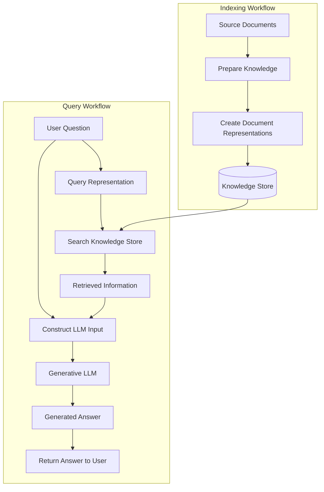

# Lesson 7: RAG Architecture

## 7.1 What Is RAG?

RAG stands for **Retrieval-Augmented Generation**.

RAG is an AI architecture that combines information retrieval with language generation. It retrieves relevant information from an external knowledge source and provides that information to a Large Language Model (LLM) as context for generating an answer.

A normal LLM generates answers using its learned parameters and the information provided in its input. It may not know the latest information or the contents of private organizational documents.

RAG helps address this limitation by retrieving relevant external information at query time.

### Simple Example

Suppose a company has a document containing its leave policy.

A user asks:

"What is our company's annual leave policy?"

A general LLM may not know the company's specific policy.

A RAG application searches the company's knowledge base, retrieves the relevant information, and passes it to the LLM.

The LLM then generates an answer using the supplied information.

### Basic RAG Flow

```text
User Question
      |
      v
Retrieve Relevant Information
      |
      v
Provide Information to the LLM
      |
      v
Generate an Answer
      |
      v
Return Answer to the User
```

### Key Learning

RAG allows an LLM to use relevant external information when answering questions without requiring the model to be retrained for every document update.

---

## 7.2 Why Do We Need RAG?

LLMs are useful for understanding questions and generating natural-language answers. However, they have limitations when working with private, frequently changing, or organization-specific information.

### Limitations of a Standalone LLM

A standalone LLM may:

- Lack access to private company documents.
- Have outdated information from its training.
- Generate plausible but incorrect answers.
- Be unable to identify the source of a specific claim.
- Require additional context to answer specialized questions accurately.

### How RAG Helps

RAG can help by:

1. Connecting the application to an external knowledge source.
2. Retrieving information relevant to the user's question.
3. Supplying the retrieved information to the LLM.
4. Allowing the application to generate an answer grounded in that information.
5. Supporting source traceability when source information is preserved.

### Example

Question:

"What are the steps for resetting my company account password?"

Without RAG, the LLM may provide generic password-reset instructions.

With RAG, the application can retrieve the company's actual account-recovery instructions and use them to answer the question.

### Benefits of RAG

- Uses external knowledge sources.
- Supports organization-specific question answering.
- Can incorporate updated information after the knowledge base is refreshed.
- Can support source references.
- Avoids the need to retrain the LLM whenever documents change.
- Allows knowledge storage and language generation to be managed separately.

### Important Limitation

RAG does not automatically eliminate hallucinations. The retrieved information may be irrelevant, incomplete, outdated, or insufficient to answer the question.

---

## 7.3 Traditional RAG Architecture

A traditional RAG system has two main workflows:

1. **Indexing workflow:** prepares and stores knowledge before user queries arrive.
2. **Query workflow:** retrieves relevant knowledge and generates answers when users ask questions.

These workflows are connected through a shared knowledge store, such as a vector database.

### Architecture Diagram



The diagram shows the overall architecture. The detailed implementation of document preparation, query representation, search, prompt construction, and answer validation is covered in later lessons.

### Main Components

**1. Source documents**

The information used by the application, such as policies, FAQs, manuals, internal knowledge articles, or approved web pages.

**2. Knowledge preparation**

The process that prepares source information for storage and future retrieval.

**3. Document representations**

Numerical representations, commonly embeddings, that support similarity-based retrieval.

**4. Knowledge store**

A storage system that keeps document representations and associated information. A vector database is a common choice.

**5. Query processing**

The application prepares the user's question for the retrieval system.

**6. Retrieval system**

Finds potentially relevant information in the knowledge store.

**7. Generative LLM**

Uses the user's question and supplied context to generate a response.

**8. Application layer**

Connects the components, manages requests, handles errors, and returns the response to the user.

### Key Learning

The knowledge store connects the indexing workflow to the query workflow. The indexing workflow prepares knowledge, while the query workflow uses that knowledge to answer questions.

---

## 7.4 The Indexing Workflow

The indexing workflow prepares the knowledge base before users ask questions.

It usually runs during initial setup and whenever the source information needs to be refreshed.

### High-Level Workflow

```text
Source Documents
      |
      v
Knowledge Preparation
      |
      v
Document Representations
      |
      v
Store Information and Metadata
      |
      v
Knowledge Base Ready
```

### Purpose of Indexing

The indexing workflow makes external information searchable by the RAG application.

It separates knowledge preparation from the process of answering user questions.

For example, a company can prepare its product manuals and support articles before a customer begins using the chatbot.

### When Is Indexing Performed?

Indexing may happen:

- When the knowledge base is created.
- When new documents are added.
- When existing documents change.
- When documents are removed.
- When an incompatible embedding model or indexing configuration changes.

Not every update requires rebuilding the entire collection. Incremental updates may be possible when the system supports them.

### Why Is This Separation Useful?

Suppose a company updates its refund policy.

The application can update the affected knowledge records without retraining the LLM.

Once the updated information is available to the retrieval system, future queries can retrieve the new policy.

### Key Learning

The indexing workflow prepares external knowledge for retrieval. It does not generate an answer for a specific user question.

---

## 7.5 The Query Workflow

The query workflow runs when a user asks a question.

It connects the user's request to the knowledge base and the generative LLM.

### High-Level Workflow

```text
User Question
      |
      v
Prepare Query
      |
      v
Search Knowledge Base
      |
      v
Retrieve Relevant Information
      |
      v
Provide Context to LLM
      |
      v
Generate Answer
      |
      v
Return Response
```

### Step 1: Receive the Question

The application receives a question from the user interface or API.

Example:

```text
How can I reset my account password?
```

### Step 2: Prepare the Query

The application prepares the question for the retrieval system.

For embedding-based retrieval, this commonly involves generating an embedding for the question.

### Step 3: Search the Knowledge Base

The retrieval system searches the available knowledge records for information related to the query.

### Step 4: Obtain Relevant Information

The system returns the selected passages or records.

These results are intended to provide information that can help answer the question.

### Step 5: Supply Context to the LLM

The application passes the question and retrieved information to the generative LLM.

### Step 6: Generate the Answer

The LLM produces a natural-language response based on its learned parameters, the instructions it receives, and the supplied context.

### Step 7: Return the Response

The application sends the generated answer to the user interface.

The application may also perform additional processing, such as checking response format or associating the answer with source information.

### Key Learning

The query workflow connects the user's question with external knowledge and uses an LLM to generate a response.

---

## 7.6 How the Indexing and Query Workflows Connect

The indexing and query workflows are different processes, but they share the same knowledge base.

### Indexing Workflow

Runs before or independently of individual user queries.

Its responsibility is to prepare and store searchable knowledge.

### Query Workflow

Runs whenever the application processes a question.

Its responsibility is to find useful information and generate a response.

### Comparison

| Feature | Indexing Workflow | Query Workflow |
|---|---|---|
| Main purpose | Prepare searchable knowledge | Answer user questions |
| Typical timing | During setup and knowledge updates | When a question arrives |
| Input | Source documents | User question |
| Output | Searchable knowledge records | Generated answer |
| Uses an LLM for answering? | Not normally required | Usually yes |
| Updates the knowledge base? | Yes | Usually no |
| Must run for every question? | No | Yes |

### Example

A support chatbot contains 5,000 help articles.

The indexing workflow prepares those articles and stores the information required for retrieval.

A user then asks a question about account recovery.

The query workflow searches the prepared knowledge base, retrieves the relevant article passage, and supplies it to the LLM.

The indexing workflow does not need to run again for every question.

### Key Learning

Indexing prepares the knowledge once and updates it when needed. Query processing reuses that knowledge for individual requests.

---

## 7.7 Main Components of a Traditional RAG System

A RAG application can be implemented using different technologies. The architecture is more important than choosing a specific library.

### 1. User Interface

The interface through which users submit questions and receive answers.

Examples include:

- Web chat widget.
- Internal company portal.
- Mobile application.
- API client.

### 2. Application Backend

The backend receives questions, coordinates retrieval and generation, and returns the result.

It may also manage authentication, sessions, request limits, error handling, and logging.

### 3. Knowledge Source

The external information used to answer questions.

Examples include:

- PDF manuals.
- Markdown files.
- Frequently asked questions.
- Product documentation.
- Approved web pages.
- Internal knowledge articles.

### 4. Embedding Model

Converts text into numerical vectors for embedding-based retrieval.

A compatible model and configuration are generally used for both document indexing and query embedding.

### 5. Vector Database

Stores embeddings and supports similarity search.

Depending on the system, it may also store original text and metadata.

### 6. Retrieval Component

Uses the search system to select relevant information for the current question.

### 7. Generative LLM

Generates the answer using the question, instructions, and available context.

### 8. Response Layer

Returns the answer to the user and handles the response format expected by the application.

### Component Relationship

```text
User
  |
  v
User Interface
  |
  v
Application Backend
  |
  +------> Retrieval Component
  |                |
  |                v
  |        Vector Database
  |                |
  |                v
  |        Retrieved Context
  |                |
  +----------------+
  |
  v
Generative LLM
  |
  v
Application Backend
  |
  v
User Interface
  |
  v
User
```

This is a simplified architecture. The backend may call the LLM and retrieval components in different orders internally, but the retrieved context must be available to the LLM if the answer is to be grounded in that context.

---

## 7.8 RAG Architecture vs a Standalone LLM

A standalone LLM and a RAG application have different architectures.

### Standalone LLM

```text
User Question
      |
      v
Generative LLM
      |
      v
Answer
```

The model generates an answer from its learned parameters and the input it receives.

### RAG Application

```text
User Question
      |
      +------> Knowledge Retrieval
                       |
                       v
               Retrieved Context
                       |
                       v
User Question ------> Generative LLM
                       |
                       v
                     Answer
```

The RAG application retrieves external information and supplies it to the model.

### Comparison

| Feature | Standalone LLM | RAG Application |
|---|---|---|
| External retrieval | Not required | Core architectural component |
| Private document access | Only if supplied through another mechanism | Can be supported through connected knowledge sources |
| Knowledge updates | May require a new source or model update | Can use updated indexed knowledge |
| Source traceability | Depends on supplied information and application features | Can preserve and expose retrieved source references |
| Architecture complexity | Usually simpler | Requires retrieval and knowledge storage components |
| Answer reliability | Depends on model and input | Depends on model, retrieval, context, and application design |

### Important Point

RAG does not automatically make every answer correct. A standalone LLM may answer many questions accurately, and a RAG application may still fail when retrieval or generation is poor.

---

## 7.9 RAG and Fine-Tuning

RAG and fine-tuning solve different problems.

### RAG

RAG supplies relevant external information at query time.

It is useful when the model needs access to changing documents, private knowledge, or information that must be retrieved from a specific source.

### Fine-Tuning

Fine-tuning updates a model's parameters through additional training.

It can be useful for adapting behavior, output formats, specialized tasks, or particular response patterns.

### Comparison

| Feature | RAG | Fine-Tuning |
|---|---|---|
| Main mechanism | Retrieves external information | Updates model parameters |
| Knowledge updates | Can update the indexed source | New training may be needed for changed knowledge |
| Requires model training? | Not for ordinary document updates | Yes |
| Can provide source records? | Yes, if the application tracks them | Not inherently |
| Common purpose | Ground answers in external knowledge | Adapt model behavior or task performance |

### Can They Be Used Together?

Yes. An application may use a fine-tuned model together with RAG.

For example, fine-tuning may help a model follow a particular response format, while RAG provides current product or policy information.

### Key Learning

RAG changes the information supplied to the model at query time. Fine-tuning changes the model through additional training.

---

## 7.10 Types of RAG Architectures

Different applications use different RAG designs.

### 1. Basic or Traditional RAG

A straightforward pipeline retrieves relevant information and supplies it to an LLM.

```text
Question
   |
   v
Retrieve
   |
   v
Generate
   |
   v
Answer
```

This is a useful starting point for learning and small applications.

### 2. Modular RAG

A modular RAG system separates functions into components that can be configured or replaced independently.

For example, retrieval, query processing, generation, and response validation may be separate modules.

This makes the architecture easier to maintain and extend.

### 3. Agentic RAG

Agentic RAG uses an agent or model-driven controller to decide which retrieval or tool actions to take.

Depending on the implementation, it may perform multiple searches, use tools, or revise its retrieval plan.

This adds flexibility but also increases complexity, latency, and the need for controls.

### 4. GraphRAG

GraphRAG uses a knowledge graph containing entities and relationships as part of its knowledge representation and retrieval process.

For example, a graph may represent relationships between employees, departments, projects, and policies.

Graph-based retrieval can be useful for questions that require following relationships between entities.

GraphRAG is a related architecture that builds on retrieval-based question answering, but it introduces graph-specific concepts that should be studied separately.

### Important Point

These designs are not necessarily mutually exclusive. A system can combine modular components, agentic behavior, vector retrieval, and graph retrieval.

---

## 7.11 RAG Architecture Example: Company Support Chatbot

Consider a company that wants to answer employee questions using internal support documents.

### Knowledge Sources

The company has:

- Account recovery instructions.
- HR policies.
- IT support documentation.
- Training materials.

### Indexing Workflow

The system prepares these sources and stores searchable document representations in its knowledge store.

### User Question

An employee asks:

```text
How can I recover access to my account?
```

### Query Workflow

1. The application receives the question.
2. The retrieval system searches the knowledge base.
3. The system returns relevant account recovery information.
4. The application supplies the question and retrieved information to the LLM.
5. The LLM generates a response.
6. The application returns the answer.

### Example Response

```text
You can recover your account by following the
account recovery instructions in the support guide.
```

This is an illustrative answer. A real application should use the actual retrieved instructions and should not invent missing steps.

### What If No Relevant Information Is Found?

The application should not assume that the LLM can safely answer every question.

Depending on its requirements, the application may:

- Ask the user to clarify the question.
- Explain that the available information does not answer it.
- Direct the user to an appropriate support channel.
- Escalate the request to a human.

### Key Learning

A RAG chatbot connects an existing knowledge base to a generative LLM so users can ask questions in natural language.

---

## 7.12 Important Architecture Considerations

When designing a RAG application, consider the following requirements.

### 1. Knowledge Freshness

The system should have a process for detecting and incorporating changes to source documents.

### 2. Latency

The application must coordinate retrieval and generation within an acceptable response time.

### 3. Scalability

The system should handle its expected number of users and requests.

### 4. Access Control

Users should retrieve only the information they are authorized to access.

### 5. Error Handling

The application should handle unavailable models, database failures, timeouts, and empty retrieval results.

### 6. Observability

Logs and metrics should help identify problems across the application, retrieval system, and LLM.

### 7. Cost

Consider embedding generation, vector storage, database queries, model inference, and infrastructure costs.

### 8. Reliability

The system should have a defined behavior when components fail or the knowledge base does not contain a suitable answer.

### 9. Maintainability

Separate components make it easier to update or replace technologies without rewriting the entire application.

### 10. Privacy and Security

Protect private documents, credentials, user data, and model inputs according to the application's requirements.

### Key Learning

A production RAG architecture must consider more than retrieval and generation. It also needs security, reliability, monitoring, and maintainability.

---

## 7.13 Common RAG Architecture Misconceptions

### Misconception 1: RAG Is a New LLM

**Correction:** RAG is an application architecture that combines retrieval with language generation. It is not a single LLM.

### Misconception 2: A Vector Database Generates Answers

**Correction:** The vector database retrieves records. A generative LLM normally generates the final answer.

### Misconception 3: RAG Automatically Trains the Model on Documents

**Correction:** Traditional RAG retrieves documents and supplies their contents to the LLM at query time. It does not automatically update the model's parameters.

### Misconception 4: More Retrieved Documents Always Improve Answers

**Correction:** Too much irrelevant context can reduce answer quality and consume the context window.

### Misconception 5: RAG Completely Eliminates Hallucinations

**Correction:** RAG can help ground answers in external information, but retrieval and generation errors can still occur.

### Misconception 6: Indexing Must Run for Every User Question

**Correction:** The indexing workflow usually runs separately. The query workflow reuses the prepared knowledge base.

### Misconception 7: RAG Requires a Vector Database in Every Implementation

**Correction:** Vector databases are common in embedding-based RAG, but retrieval can also use other search systems or knowledge stores.

---

## 7.14 Interview Questions and Answers

### Q1. What is RAG?

RAG is an architecture that retrieves relevant external information and supplies it to an LLM to help generate an answer.

### Q2. Why is RAG useful?

It allows applications to use private, domain-specific, or updated information without retraining the LLM for every document change.

### Q3. What are the two main workflows in traditional RAG?

The indexing workflow prepares searchable knowledge. The query workflow retrieves relevant information and generates an answer.

### Q4. What is the role of the vector database?

It stores vectors and supports similarity search for finding potentially relevant information.

### Q5. What is the role of the embedding model?

It converts text into numerical vectors used by the retrieval system.

### Q6. What is the role of the generative LLM?

It generates the response using the user's question, instructions, and supplied context.

### Q7. Does RAG require fine-tuning?

No. A traditional RAG system can work with an existing LLM without fine-tuning. Fine-tuning can be added if there is a separate need to adapt model behavior.

### Q8. How can a RAG system use updated documents?

The application updates or re-indexes the affected knowledge records. Future queries can then retrieve the updated information.

### Q9. What happens if retrieval finds no relevant information?

The application can ask for clarification, explain that it lacks sufficient information, or direct the user to an appropriate support channel.

### Q10. Does RAG guarantee accurate answers?

No. Accuracy depends on the quality of the source data, retrieval, supplied context, and generated response.

### Q11. Can RAG use sources other than vector databases?

Yes. It can use other retrieval systems, including keyword search, relational data stores, and graph databases, depending on the architecture.

### Q12. What is the difference between traditional RAG and GraphRAG?

Traditional RAG commonly retrieves relevant text passages. GraphRAG uses a knowledge graph containing entities and relationships as part of its retrieval and reasoning workflow.

### Q13. Why separate indexing and query processing?

Separation allows knowledge to be prepared and updated independently of individual user requests, reducing unnecessary repeated work.

### Q14. What are the major components of a RAG system?

Common components include a knowledge source, indexing process, knowledge store, retrieval component, application backend, generative LLM, and user interface.

### Q15. What are the main challenges in production RAG?

Common challenges include retrieval relevance, response latency, knowledge freshness, access control, scalability, reliability, and unsupported answers.

---

## 7.15 Key Learning Summary

- RAG stands for Retrieval-Augmented Generation.
- RAG combines information retrieval with language generation.
- External information is retrieved and supplied to an LLM as context.
- Traditional RAG has separate indexing and query workflows.
- Indexing prepares searchable knowledge before or independently of user queries.
- Query processing retrieves information and generates responses.
- The embedding model represents text as vectors.
- The knowledge store contains searchable information.
- The retrieval component finds potentially relevant content.
- The generative LLM generates the final answer.
- RAG can use updated knowledge without retraining the LLM for each document update.
- RAG does not guarantee factual accuracy.
- Production systems need appropriate security, error handling, scalability, and monitoring.

**Final takeaway:** Traditional RAG connects a knowledge base to a generative LLM. The indexing workflow prepares the knowledge, and the query workflow retrieves relevant information to help the LLM answer the user's question.

---

## 7.16 Practical Learning Checklist

- [ ] Explain RAG in your own words.
- [ ] Draw the basic RAG architecture.
- [ ] Identify the main components of a RAG application.
- [ ] Explain the indexing workflow.
- [ ] Explain the query workflow.
- [ ] Describe how both workflows share a knowledge store.
- [ ] Compare a standalone LLM with a RAG application.
- [ ] Explain the difference between RAG and fine-tuning.
- [ ] Identify common RAG architecture designs.
- [ ] Explain why RAG does not guarantee accurate answers.
- [ ] Describe important security and reliability requirements.
