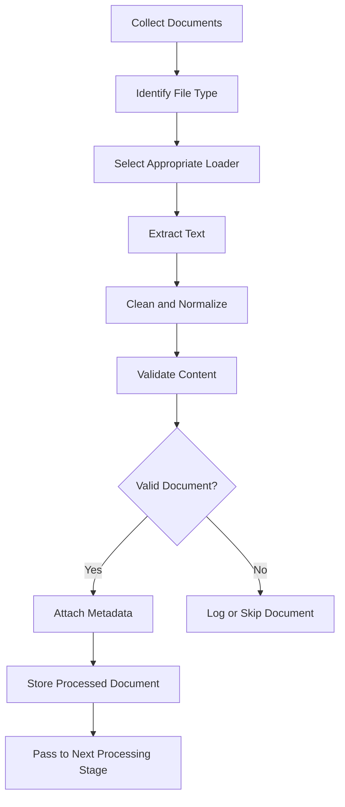

# Lesson 8: Document Ingestion


## 8.1 What Is Document Ingestion?

Document ingestion is the process of collecting documents from different sources, extracting their content, cleaning the extracted data, validating it, and preparing it for further processing.

In a document-based AI application, information may come from PDFs, Word documents, websites, Markdown files, plain-text files, or internal knowledge bases.

These sources often have different formats. Document ingestion converts their content into a consistent, usable representation.

### Example

Suppose a company has these documents:

- `employee_handbook.pdf`
- `leave_policy.docx`
- `company_faq.txt`
- `product_documentation.md`

A document ingestion system reads these files, extracts their text, cleans unnecessary characters, checks whether the content is valid, and records information about each source.

The resulting documents can then be passed to the next processing stage.

### Main objectives

1. Collect documents from supported sources.
2. Extract readable content.
3. Normalize inconsistent formatting.
4. Validate extracted content.
5. Handle missing, empty, or unreadable files.
6. Preserve information about the original source.
7. Make ingestion repeatable and reliable.

---

## 8.2 Why Is Document Ingestion Important?

The quality of the ingested documents affects the quality of the entire downstream pipeline.

Poorly extracted text can introduce missing information, broken sentences, duplicated content, or incorrect character encoding.

### Common problems

| Problem | Example | Possible solution |
|---|---|---|
| Empty file | A file contains no text | Skip it and record the reason |
| Incorrect encoding | Special characters appear incorrectly | Use the appropriate encoding |
| Scanned PDF | The PDF contains page images instead of selectable text | Apply OCR when required |
| Repeated headers | Every page repeats the company name | Remove known repeated patterns |
| Broken formatting | Words are separated by unnecessary line breaks | Normalize whitespace carefully |
| Duplicate files | The same document is uploaded twice | Compare stable IDs or content hashes |
| Unsupported format | A loader receives an unknown file type | Reject it with a clear error |
| Corrupted file | A parser cannot open the document | Log the error and continue when appropriate |

Document ingestion should preserve meaningful information while removing formatting noise.

**Important:** Cleaning should not change the original meaning of the document.

---

## 8.3 Document Ingestion Workflow

A typical ingestion workflow consists of the following stages.



### Stage 1: Collect documents

Identify where the documents originate.

Examples:

- Local folders
- Uploaded files
- Company websites
- Cloud storage
- Document management systems
- Internal APIs

### Stage 2: Identify file type

Determine the format before choosing a loader.

For example:

- `.txt` → text loader
- `.md` → Markdown loader
- `.pdf` → PDF parser
- `.docx` → Word document parser
- `.html` → HTML parser

The file extension is useful, but it should not always be trusted as proof of the actual file format.

### Stage 3: Extract text

Read the document and convert its contents into text or another appropriate representation.

Different formats require different extraction libraries.

### Stage 4: Clean and normalize

Remove unwanted whitespace, normalize line endings, and handle obvious formatting problems without changing the meaning.

### Stage 5: Validate content

Check whether the extracted content is usable.

For example:

- Is the text empty?
- Is the file readable?
- Did extraction return an error?
- Is the extracted content unexpectedly short?
- Are required fields available?

### Stage 6: Attach metadata

Record information about the document, such as its source path, title, identifier, file type, and modification time.

### Stage 7: Store the result

Save the processed text and its metadata in a consistent format, such as JSON or a database.

---

## 8.4 Supported Document Types

### 8.4.1 Plain-text files

Extensions: `.txt`

Plain-text files are among the simplest formats to process. Python can read them directly.

```python
from pathlib import Path

path = Path("data/sample_documents/example.txt")
text = path.read_text(encoding="utf-8")
```

Advantages:

- Simple to read
- Easy to test
- No external parser required
- Suitable for initial learning exercises

Limitations:

- Text files do not preserve rich document formatting.
- Files may use different encodings.

### 8.4.2 Markdown files

Extension: `.md`

Markdown files contain text with lightweight formatting, such as headings, lists, links, and code blocks.

```python
from pathlib import Path

path = Path("notes/example.md")
text = path.read_text(encoding="utf-8")

print(text)
```

Markdown can generally be read as plain text. Whether its formatting markers should be preserved depends on the application.

For example, headings can be useful because they identify the structure and subject of a section.

### 8.4.3 PDF files

Extension: `.pdf`

PDFs can contain selectable text, scanned page images, tables, diagrams, and mixed content.

A PDF extraction library can extract selectable text, but it may not correctly reproduce the reading order of complex layouts.

Example using `pypdf`:

```python
from pathlib import Path
from pypdf import PdfReader


def load_pdf(path: str) -> str:
    file_path = Path(path)

    if not file_path.is_file():
        raise FileNotFoundError(f"File not found: {path}")

    reader = PdfReader(str(file_path))
    pages = []

    for page in reader.pages:
        text = page.extract_text() or ""
        pages.append(text)

    return "\n\n".join(pages).strip()


if __name__ == "__main__":
    content = load_pdf("data/sample_documents/example.pdf")
    print(content)
```

Install the library:

```bash
python -m pip install pypdf
```

Limitations:

- Scanned PDFs may require OCR.
- Tables may be extracted incorrectly.
- Multi-column layouts may produce text in the wrong order.
- Some PDFs contain little or no extractable text.

OCR means Optical Character Recognition. It converts text visible in images into machine-readable text.

### 8.4.4 Word documents

Extension: `.docx`

Word documents may contain paragraphs, headings, tables, and other structured content.

The `python-docx` library can extract paragraphs and tables.

Install it:

```bash
python -m pip install python-docx
```

Example:

```python
from pathlib import Path
from docx import Document


def load_docx(path: str) -> str:
    file_path = Path(path)

    if not file_path.is_file():
        raise FileNotFoundError(f"File not found: {path}")

    document = Document(str(file_path))

    paragraphs = [
        paragraph.text
        for paragraph in document.paragraphs
        if paragraph.text.strip()
    ]

    return "\n".join(paragraphs)


if __name__ == "__main__":
    content = load_docx("data/sample_documents/example.docx")
    print(content)
```

This example extracts paragraphs but does not extract table contents. A production loader should explicitly handle tables and other required document elements.

### 8.4.5 HTML pages

HTML is commonly used for web pages.

HTML documents contain both readable text and markup such as tags, scripts, and navigation elements.

A parser can extract the visible textual content while excluding irrelevant elements.

Install Beautiful Soup:

```bash
python -m pip install beautifulsoup4
```

Example:

```python
from bs4 import BeautifulSoup


def extract_html_text(html: str) -> str:
    soup = BeautifulSoup(html, "html.parser")

    for element in soup(["script", "style", "noscript"]):
        element.decompose()

    return soup.get_text(separator=" ", strip=True)
```

This function parses HTML that is already available as a string. Fetching web pages is a separate task and may require authentication, permission checks, or handling of dynamically rendered content.

### 8.4.6 Other document sources

Larger applications may ingest content from:

- CSV and spreadsheet files
- Internal APIs
- Cloud storage
- Content management systems
- Databases
- Knowledge management platforms

Each source requires an appropriate connector or parser.

The loader should return a consistent representation regardless of where the document originated.

---

## 8.5 Project Folder Structure

For this lesson, use the following structure:

```text
rag-graphrag-learning/
├── data/
│   └── sample_documents/
│       ├── example.txt
│       ├── policy.txt
│       └── product_guide.txt
├── notes/
│   └── 08-document-ingestion.md
├── src/
│   └── ingestion/
│       ├── __init__.py
│       └── text_loader.py
└── .venv/
```

### Create the directories

From the project root, run:

```bash
mkdir -p src/ingestion
mkdir -p data/sample_documents
touch src/ingestion/__init__.py
```

The `__init__.py` file marks the directory as a Python package. It can be empty.

---

## 8.6 Practical Implementation: Load a Text File

Create:

`src/ingestion/text_loader.py`

```python
from pathlib import Path


def load_text_file(path: str) -> str:
    """Read a UTF-8 text file and return its content."""
    file_path = Path(path)

    if not file_path.is_file():
        raise FileNotFoundError(f"File not found: {path}")

    return file_path.read_text(encoding="utf-8").strip()


if __name__ == "__main__":
    project_root = Path(__file__).resolve().parents[2]

    sample_file = (
        project_root
        / "data"
        / "sample_documents"
        / "example.txt"
    )

    content = load_text_file(str(sample_file))
    print(content)
```

### Understanding the code

**`from pathlib import Path`**

Imports Python's path-handling utility. It makes file paths easier to work with across operating systems.

**`Path(path)`**

Converts the supplied path string into a `Path` object.

**`file_path.is_file()`**

Checks whether the path points to an existing file.

**`read_text(encoding="utf-8")`**

Reads the file as text using UTF-8 encoding.

**`.strip()`**

Removes whitespace at the beginning and end of the extracted text.

**`Path(__file__).resolve().parents[2]`**

Finds the project root based on the location of the Python script. This avoids relying on the terminal's current working directory.

### Create the sample document

Create:

`data/sample_documents/example.txt`

Add this content:

```text
Document Ingestion

Document ingestion collects information from different sources
and prepares it for further processing.

A text loader reads the content of a text file. The extracted
content can then be cleaned, validated, and associated with
metadata describing its original source.
```

### Run the script

Activate your virtual environment if it is not already active:

```bash
source .venv/bin/activate
```

Run:

```bash
python src/ingestion/text_loader.py
```

Expected output:

```text
Document Ingestion

Document ingestion collects information from different sources
and prepares it for further processing.

A text loader reads the content of a text file. The extracted
content can then be cleaned, validated, and associated with
metadata describing its original source.
```

---

## 8.7 Load Multiple Text Files

A document ingestion system often needs to read multiple files rather than just one.

Python's `Path.glob()` can find files matching a pattern.

Create a script or extend the existing loader:

```python
from pathlib import Path


def load_text_file(path: Path) -> str:
    if not path.is_file():
        raise FileNotFoundError(f"File not found: {path}")

    return path.read_text(encoding="utf-8").strip()


def load_directory(directory: str) -> list[dict[str, str]]:
    root = Path(directory)

    if not root.is_dir():
        raise NotADirectoryError(
            f"Directory not found: {directory}"
        )

    documents = []

    for file_path in sorted(root.glob("*.txt")):
        try:
            content = load_text_file(file_path)

            if not content:
                print(f"Skipping empty file: {file_path.name}")
                continue

            documents.append(
                {
                    "source": str(file_path),
                    "filename": file_path.name,
                    "text": content,
                }
            )

        except (OSError, UnicodeError) as error:
            print(f"Could not load {file_path.name}: {error}")

    return documents


if __name__ == "__main__":
    project_root = Path(__file__).resolve().parents[2]
    input_directory = project_root / "data" / "sample_documents"

    documents = load_directory(str(input_directory))

    print(f"Successfully loaded {len(documents)} documents.")

    for document in documents:
        print(f"\nSource: {document['filename']}")
        print(document["text"])
```

### How it works

1. Checks whether the directory exists.
2. Finds `.txt` files.
3. Sorts filenames for predictable processing order.
4. Loads each file.
5. Skips files with empty content.
6. Reports files that cannot be read.
7. Returns a list of successfully loaded documents.

### Example result

```text
Successfully loaded 3 documents.

Source: example.txt
Document Ingestion
...

Source: policy.txt
Company Policy
...
```

The number of documents depends on the files present in your directory.

**Note:** `glob("*.txt")` searches only the specified directory, not its subdirectories. Use `rglob("*.txt")` if recursive discovery is required.

---

## 8.8 Text Cleaning and Normalization

Extracted content often contains formatting noise. Basic normalization can make the content more consistent.

Common operations include:

- Removing leading and trailing whitespace.
- Normalizing line endings.
- Removing unwanted null characters.
- Reducing excessive spaces.
- Preserving meaningful paragraph boundaries.

### Example

Input:

```text
    Document Ingestion


    It prepares documents      for processing.

```

After basic normalization:

```text
Document Ingestion

It prepares documents for processing.
```

### Python implementation

```python
import re


def clean_text(text: str) -> str:
    # Remove null characters.
    text = text.replace("\x00", "")

    # Normalize Windows and old-style line endings.
    text = text.replace("\r\n", "\n")
    text = text.replace("\r", "\n")

    # Replace tabs and repeated horizontal spaces.
    text = re.sub(r"[^\S\n]+", " ", text)

    # Reduce runs of three or more newlines to two.
    text = re.sub(r"\n{3,}", "\n\n", text)

    # Remove whitespace from the beginning and end.
    return text.strip()


if __name__ == "__main__":
    sample = """
        Document Ingestion


        It prepares documents      for processing.
    """

    print(clean_text(sample))
```

### Important cleaning considerations

Do not automatically remove all punctuation, numbers, symbols, or line breaks.

For example:

- A product code such as `AB-123` may be important.
- A mathematical expression may depend on its symbols.
- A heading may help identify a section.
- A policy may depend on dates, amounts, or percentages.

Cleaning rules should match the source format and the application's needs.

---

## 8.9 Handling Empty Documents

A file may exist but contain no useful text.

Examples include:

- An empty text file.
- A PDF with no extractable text.
- A Word document containing only images.
- A web page from which no readable content was extracted.

Check the content after extraction and basic cleaning.

```python
def validate_text(text: str) -> bool:
    return bool(text and text.strip())
```

Usage:

```python
content = "   \n  "

if validate_text(content):
    print("Document is valid.")
else:
    print("Document is empty.")
```

Output:

```text
Document is empty.
```

An empty document should usually be skipped or marked as failed rather than passed silently to the next stage.

A non-empty result is not necessarily correct, however. For important documents, additional checks may be needed to detect extraction failures or unexpectedly short content.

---

## 8.10 Encoding and File Errors

### 8.10.1 What is character encoding?

Character encoding defines how text characters are represented as bytes.

UTF-8 is a widely used encoding and is a sensible default for text files.

A file created using another encoding may fail to decode as UTF-8.

### Example

```python
from pathlib import Path


def load_text_file(path: str) -> str:
    file_path = Path(path)

    if not file_path.is_file():
        raise FileNotFoundError(f"File not found: {path}")

    return file_path.read_text(encoding="utf-8")
```

This function deliberately raises an error if the file cannot be decoded as UTF-8.

### 8.10.2 Handling common errors

```python
from pathlib import Path


def safe_load_text(path: str) -> str | None:
    file_path = Path(path)

    try:
        return file_path.read_text(encoding="utf-8")

    except FileNotFoundError:
        print(f"File does not exist: {path}")

    except UnicodeDecodeError:
        print(f"File is not valid UTF-8 text: {path}")

    except PermissionError:
        print(f"Permission denied: {path}")

    except OSError as error:
        print(f"File could not be read: {error}")

    return None
```

Returning `None` indicates that loading failed. The caller must check the result before using it.

### Should you use `errors="ignore"`?

Python supports:

```python
text = file_path.read_text(
    encoding="utf-8",
    errors="ignore",
)
```

This ignores decoding errors, but it can silently remove characters and change the content.

For learning and reliable ingestion, explicit error handling is generally preferable. If another encoding is expected, identify it and decode the file appropriately.

---

## 8.11 Document Metadata

Metadata is information that describes a document.

It does not have to be part of the document's visible text. Instead, it is stored alongside the extracted content.

### Common metadata fields

| Field | Purpose | Example |
|---|---|---|
| `document_id` | Identifies the document | `doc_001` |
| `source` | Records where the document came from | `data/sample_documents/policy.txt` |
| `filename` | Original filename | `policy.txt` |
| `title` | Human-readable document title | `Company Policy` |
| `file_type` | Identifies the format | `txt` |
| `updated_at` | Records the last-modified time | ISO 8601 timestamp |
| `file_size_bytes` | Records the original file size | `2048` |
| `content_hash` | Helps detect content changes | SHA-256 digest |
| `access_level` | Represents an access classification | `internal` |

Metadata requirements depend on the application. Not every field is necessary for every project.

### Why metadata matters

Metadata can help:

- Trace extracted text back to its source.
- Identify which document was updated.
- Detect repeated or changed files.
- Organize documents.
- Diagnose ingestion failures.
- Preserve source information for later processing.

Metadata alone does not enforce access control. An application must also verify permissions before exposing protected content.

### Create metadata in Python

```python
from pathlib import Path
from datetime import datetime, timezone
import hashlib


def build_document_record(path: str, text: str) -> dict:
    file_path = Path(path)
    content_hash = hashlib.sha256(
        text.encode("utf-8")
    ).hexdigest()

    stat = file_path.stat()

    return {
        "document_id": content_hash,
        "source": str(file_path.resolve()),
        "filename": file_path.name,
        "file_type": file_path.suffix.lstrip(".").lower(),
        "file_size_bytes": stat.st_size,
        "updated_at": datetime.fromtimestamp(
            stat.st_mtime,
            tz=timezone.utc,
        ).isoformat(),
        "content_hash": content_hash,
        "text": text,
    }
```

### Understanding the code

- `hashlib.sha256()` calculates a content hash.
- `stat()` reads filesystem information about the file.
- `stat().st_size` provides the file size in bytes.
- `stat().st_mtime` provides the modification time.
- `datetime.fromtimestamp()` converts the modification time into a readable timestamp.
- `resolve()` records an absolute source path.

In this example, `document_id` is derived from the extracted text. Identical text produces the same ID, even if the files have different names.

This is useful for identifying identical content, but it may not be suitable when two separately managed documents must retain different identities. In that situation, use a stable source-system ID or another explicit identity scheme.

Also, a content hash based on extracted text will not detect every change to the original file. A file can change without changing its extracted text.

---

## 8.12 Saving Ingested Documents as JSON

JSON is a convenient format for inspecting the output of a learning exercise.

A processed document can contain both extracted text and metadata.

### Example output structure

```json
{
  "document_id": "example-id",
  "source": "data/sample_documents/example.txt",
  "filename": "example.txt",
  "file_type": "txt",
  "text": "Document Ingestion prepares content for processing."
}
```

The ID above is illustrative, not a real calculated hash.

### Python implementation

```python
import json
from pathlib import Path


def save_documents(
    documents: list[dict],
    output_path: str,
) -> None:
    destination = Path(output_path)
    destination.parent.mkdir(parents=True, exist_ok=True)

    with destination.open("w", encoding="utf-8") as file:
        json.dump(
            documents,
            file,
            ensure_ascii=False,
            indent=2,
        )


if __name__ == "__main__":
    example_documents = [
        {
            "document_id": "doc_001",
            "source": "data/sample_documents/example.txt",
            "filename": "example.txt",
            "file_type": "txt",
            "text": "Example document content.",
        }
    ]

    save_documents(
        example_documents,
        "data/processed_documents.json",
    )

    print("Documents saved successfully.")
```

### Important points

- `json.dump()` writes Python data to a JSON file.
- `ensure_ascii=False` preserves readable Unicode characters.
- `indent=2` makes the file easier to inspect.
- `mkdir(..., exist_ok=True)` creates the output directory when needed.

For a larger application, JSON files are useful for intermediate output, while a database or object store may be more suitable for managing large collections.

---

## 8.13 Stable Document IDs and Duplicate Detection

A document ID should help identify a document consistently.

There are several possible strategies.

### Strategy 1: Source-system identifier

Use a stable ID assigned by the source system.

Example:

```text
document_id = "company-policy-123"
```

This is often a good choice when the source system already provides reliable identifiers.

### Strategy 2: Content hash

Calculate a hash from the document's bytes or extracted text.

```python
import hashlib


def calculate_text_hash(text: str) -> str:
    return hashlib.sha256(
        text.encode("utf-8")
    ).hexdigest()
```

Identical text produces the same hash.

Advantages:

- Useful for identifying identical content.
- Does not depend on the filename.
- Useful for checking whether extracted text has changed.

Limitations:

- A small text change produces a different hash.
- Different files can have identical content.
- The hash does not explain which document is authoritative.

### Strategy 3: Application-managed ID

Generate an identifier and store it in a database.

This works when documents need persistent identities that are independent of their content.

### Important distinction

A document's identity and its content version are different concepts.

For example, `company-policy-123` might refer to the same logical policy over time, while its content hash changes whenever the policy text changes.

A robust ingestion system may track both.

---

## 8.14 Document Ingestion Logging

Logging records what happened during ingestion.

Useful information includes:

- Which document was processed.
- Whether loading succeeded.
- Whether content was empty.
- Why a document failed.
- How many documents were processed.
- When a processing run occurred.

### Basic logging example

```python
import logging
from pathlib import Path

logging.basicConfig(
    level=logging.INFO,
    format="%(asctime)s %(levelname)s %(message)s",
)


def load_text_file(path: str) -> str:
    file_path = Path(path)

    if not file_path.is_file():
        logging.error("File does not exist: %s", path)
        raise FileNotFoundError(path)

    try:
        text = file_path.read_text(encoding="utf-8").strip()

        if not text:
            logging.warning("Empty document: %s", path)
            return ""

        logging.info("Loaded document: %s", path)
        return text

    except (OSError, UnicodeError):
        logging.exception("Failed to load document: %s", path)
        raise
```

### Why use logging instead of only `print()`?

`print()` is convenient for small exercises.

The `logging` module provides severity levels, timestamps, and configurable output, making it more useful as the application grows.

Typical levels include:

- `DEBUG`: Detailed diagnostic information.
- `INFO`: Normal processing events.
- `WARNING`: Unexpected but recoverable conditions.
- `ERROR`: A processing operation failed.
- `CRITICAL`: A serious application-level problem.

Avoid logging passwords, access tokens, or sensitive document contents.

---

## 8.15 Making Ingestion Repeatable and Reliable

A reliable ingestion pipeline should be safe to run more than once.

Consider a folder containing 100 documents. If the same folder is processed every day, the system should not blindly create duplicate records each time.

Useful design practices include:

### 1. Track document identity

Use source IDs, file identifiers, or content hashes to identify existing documents.

### 2. Track document changes

Compare modification timestamps, source versions, or content hashes.

### 3. Handle failures individually

One unreadable file should not necessarily prevent other valid files from being processed.

### 4. Record processing status

Possible statuses include:

```text
pending
processing
success
skipped
failed
```

### 5. Make updates safe

When the content of an existing document changes, update the corresponding record instead of creating an uncontrolled duplicate.

### 6. Keep original sources traceable

Record the original source and enough information to diagnose extraction problems.

### 7. Separate temporary and final output

Write intermediate data to a temporary location when appropriate, then replace the final output only after successful processing.

For more advanced applications, consider atomic writes, retries, monitoring, and recovery from interrupted jobs.

---

## 8.16 Common Document Ingestion Mistakes

### Mistake 1: Assuming every PDF contains extractable text

Some PDFs are scanned images. They may require OCR.

### Mistake 2: Treating every file as UTF-8 text

PDFs and Word files are not plain-text files. Even text files can use other encodings.

### Mistake 3: Ignoring extraction errors

A failed extraction should be recorded instead of silently treated as an empty, successfully processed document.

### Mistake 4: Cleaning too aggressively

Removing punctuation, numbers, headings, or paragraph breaks can destroy important information.

### Mistake 5: Losing the original source

If the source is not recorded, it becomes difficult to trace a problem back to the correct file.

### Mistake 6: Using filenames as permanent IDs

Filenames can change, and different folders may contain files with the same name.

### Mistake 7: Assuming metadata guarantees security

A stored access label does not automatically prevent unauthorized access. Permission checks must be enforced by the application.

### Mistake 8: Assuming successful loading means successful extraction

A parser can return text that is incomplete, incorrectly ordered, or mostly noise. Extraction quality may require additional checks.

---


## 8.23 Interview Questions and Answers

### Q1. What is document ingestion?

Document ingestion collects documents, extracts their content, normalizes and validates the data, and prepares it for further processing.

### Q2. Why are different loaders needed?

Different file formats have different internal structures. A PDF parser, for example, must handle a different format from a plain-text file reader.

### Q3. What is the difference between extraction and cleaning?

Extraction obtains content from a source file. Cleaning normalizes the extracted content and removes unwanted formatting noise.

### Q4. What is OCR?

Optical Character Recognition converts text present in images into machine-readable text. It is useful for scanned documents.

### Q5. Why is metadata useful?

Metadata records information about a document's source, identity, type, and modification time. It helps organize and trace documents.

### Q6. Why should empty documents be skipped?

Empty documents provide no useful textual content for downstream processing and may waste storage and processing resources.

### Q7. What is a content hash?

A content hash is a fixed-length value calculated from content. It can help identify identical content and detect changes.

### Q8. Why should ingestion errors be logged?

Logging makes failures visible and helps developers diagnose missing files, decoding problems, parser errors, and other issues.

### Q9. Should all whitespace be removed?

No. Excessive whitespace can be normalized, but meaningful paragraph boundaries, headings, and formatting should be preserved where useful.

### Q10. Does successful text extraction guarantee good-quality content?

No. Extracted text can be incomplete, incorrectly ordered, or corrupted. Important applications should validate extraction quality.

### Q11. What is the difference between a document ID and a content hash?

A document ID identifies a document within an application or source system. A content hash identifies specific content. A document's content can change while its logical identity remains the same.

### Q12. How can ingestion avoid processing duplicate content repeatedly?

It can compare stable source identifiers, content hashes, versions, or stored processing records before creating or updating a document record.

---

## 8.24 Key Takeaways

1. Document ingestion prepares information from different sources for further processing.
2. Different formats require appropriate loaders or parsers.
3. Text extraction and text cleaning are separate operations.
4. Validation helps detect empty or unusable content.
5. Metadata preserves information about document identity and origin.
6. Content hashes can help detect identical or changed content.
7. Error handling and logging make ingestion more reliable.
8. Repeatable ingestion should account for existing documents and changed content.
9. Scanned and complex documents may require specialized extraction techniques.
10. Always preserve meaningful information and make source documents traceable.

**Lesson completion goal:** Build a Python script that loads multiple text files, cleans and validates their contents, attaches metadata, handles errors, and saves the resulting document records to JSON.
