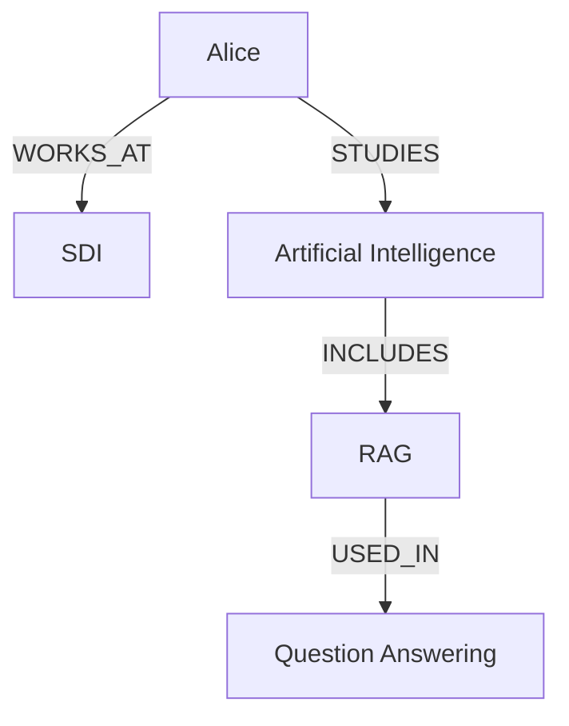
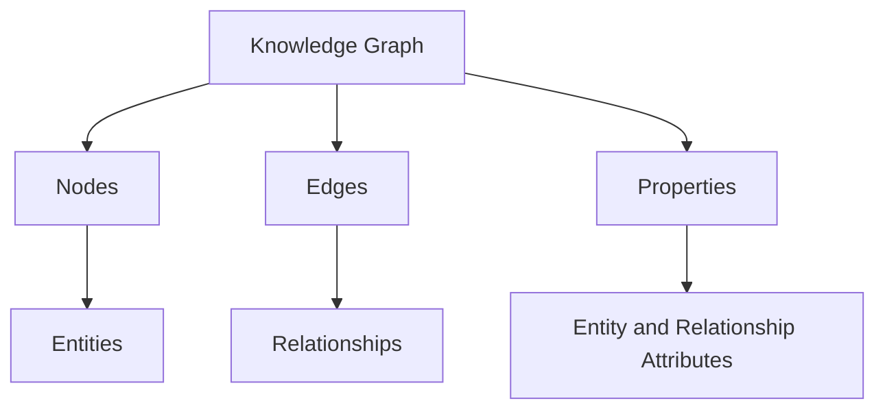
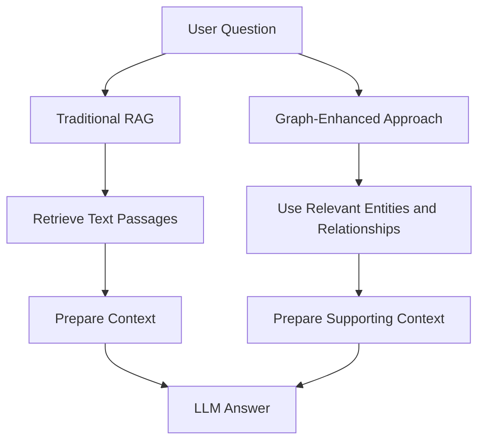

# Lesson 15: Knowledge Graphs

## 1. Definition

### 1.1 What is a Knowledge Graph?

A knowledge graph is a way of representing information as entities and the relationships between them.

Instead of storing information only as separate text documents, a knowledge graph connects related pieces of information so that their relationships are explicit.

For example, consider these facts:

- Alice works at SDI.
- Alice studies Artificial Intelligence.
- Artificial Intelligence includes the topic RAG.
- RAG is used in question-answering systems.

These facts can be represented as a graph:

```text
Alice
  |
  | WORKS_AT
  v
 SDI

Alice
  |
  | STUDIES
  v
Artificial Intelligence
  |
  | INCLUDES
  v
 RAG
  |
  | USED_IN
  v
Question-Answering Systems
```

The example is hypothetical and is intended only for learning.

### 1.2 What is a Triple?

A triple represents a fact using three elements:

```text
(Subject, Predicate, Object)
```

Example:

```text
(Alice, WORKS_AT, SDI)
```

The three elements are:

- **Subject:** The entity from which the relationship starts.
- **Predicate:** The relationship connecting the entities.
- **Object:** The entity to which the relationship points.

Another example:

```text
(Alice, STUDIES, Artificial Intelligence)
```

This triple expresses the fact that Alice studies Artificial Intelligence.

Triples provide a simple way to convert facts expressed in natural language into structured relationships.

### 1.3 What is GraphRAG?

GraphRAG is an approach that combines knowledge graphs with retrieval-augmented generation (RAG).

Traditional RAG commonly retrieves relevant text passages using semantic similarity, keyword search, or a combination of retrieval methods.

Knowledge graphs represent entities and relationships explicitly. This can provide additional context when information is spread across several documents or when the relationships between entities matter.

For example, a question might ask how one technical topic relates to another through an organization, project, or person.

A knowledge graph can represent those connections explicitly.

**Important:** A knowledge graph is a data representation. GraphRAG is a broader approach that uses graph information as part of a retrieval and generation system. A graph by itself does not automatically make an application GraphRAG.

This lesson focuses on graph fundamentals and implementation. Graph construction pipelines, GraphRAG retrieval strategies, community detection, and community summaries are covered in later lessons.

---

## 2. Why It Matters

### 2.1 Limitations of Document-Only Representation

Imagine that three documents contain the following information.

**Document 1**

```text
Alice works at SDI.
```

**Document 2**

```text
Alice studies Artificial Intelligence.
```

**Document 3**

```text
Artificial Intelligence includes RAG.
```

Each document contains a useful fact. However, the relationships are not stored together as a connected structure.

A knowledge graph can represent the facts as:

```text
Alice --WORKS_AT--> SDI
Alice --STUDIES--> Artificial Intelligence
Artificial Intelligence --INCLUDES--> RAG
```

This makes the relationships explicit and allows a program to navigate between connected entities.

### 2.2 Benefits of Knowledge Graphs

Knowledge graphs provide several benefits.

1. **Explicit relationships:** Facts are represented as named connections rather than existing only in text.
2. **Connected information:** Related entities can be linked even when their facts come from different documents.
3. **Multi-step connections:** A graph can represent paths containing multiple relationships.
4. **Structured data:** Entities and relationships can have properties and types.
5. **Traceability:** Relationships can record source document identifiers or supporting evidence.
6. **Domain modeling:** A graph can represent people, organizations, projects, concepts, products, and other domain objects.

### 2.3 Knowledge Graphs in RAG

A traditional RAG application typically uses a flow such as:

```text
Question
   |
   v
Retrieve Relevant Text
   |
   v
Build Context
   |
   v
LLM Generates Answer
```

A graph-enhanced RAG application may also use explicit relationships between entities when assembling relevant context.

For example, an application could represent:

```text
User Question
      |
      v
Identify Relevant Entities
      |
      v
Use Graph Relationships
      |
      v
Assemble Supporting Context
      |
      v
LLM Generates Answer
```

This second diagram is a conceptual illustration, not a complete implementation of a GraphRAG retrieval pipeline.

### 2.4 When Should You Use a Knowledge Graph?

Knowledge graphs are especially useful when:

- Information contains many interconnected entities.
- Questions depend on relationships between entities.
- Data comes from multiple sources.
- You need to track how entities are connected.
- You need explicit relationship types and source references.

A knowledge graph may be unnecessary when the application only needs to retrieve a few independent text passages.

The choice depends on the problem, complexity, maintenance cost, and expected benefits.

---

## 3. Key Concepts

### 3.1 Graph

A graph is a mathematical structure consisting of nodes and edges.

A graph can be represented as:

```text
G = (V, E)
```

Where:

- `G` represents the graph.
- `V` represents the set of vertices or nodes.
- `E` represents the set of edges or relationships.

For example:

```text
Alice ---> SDI
```

Here, Alice and SDI are nodes, and the arrow represents an edge.

### 3.2 Node

A node represents an entity or object.

Examples:

- Alice
- SDI
- Artificial Intelligence
- RAG
- A project
- A document

A node can contain properties.

Example:

```python
{
    "name": "Alice",
    "entity_type": "Person"
}
```

The properties describe the entity.

### 3.3 Edge

An edge represents a relationship between nodes.

Example:

```text
Alice --WORKS_AT--> SDI
```

The edge connects Alice and SDI.

A relationship can also have properties such as:

- Source document ID
- Confidence score
- Evidence text
- Relationship date

Example:

```python
{
    "relation": "WORKS_AT",
    "source_document_id": "doc_001"
}
```

### 3.4 Directed Graph

A directed graph represents edges with a direction.

Example:

```text
Alice ---> SDI
```

The direction is from Alice to SDI.

In NetworkX, a directed graph can be created using `nx.DiGraph()`.

The direction of a relationship must be selected according to its meaning.

For example:

```text
Alice --WORKS_AT--> SDI
```

does not mean the same thing as:

```text
SDI --WORKS_AT--> Alice
```

If a relationship is intended to be symmetric, the application must define how to represent or query that symmetry.

### 3.5 Undirected Graph

An undirected graph represents connections without a specified direction.

Example:

```text
Alice ----- Bob
```

This can represent an undirected connection such as a friendship, if that matches the intended data model.

In NetworkX:

```python
import networkx as nx

graph = nx.Graph()
```

Use an undirected graph only when the relationship does not require direction.

### 3.6 Property Graph

A property graph stores properties on nodes and relationships.

Example:

```text
Alice
  |
  | WORKS_AT
  | since_year = 2022
  v
SDI
```

The node for Alice might have:

```python
{
    "name": "Alice",
    "entity_type": "Person"
}
```

The relationship might have:

```python
{
    "relation": "WORKS_AT",
    "since_year": 2022
}
```

This representation allows the graph to store more information than entity names alone.

### 3.7 Triple

A triple represents a fact as:

```text
Subject -> Predicate -> Object
```

Example:

```text
(RAG, USES, Retrieved Context)
```

This means that RAG uses retrieved context.

A collection of triples can represent a knowledge graph.

### 3.8 Traversal

Traversal means following edges to move between nodes.

Consider:

```text
Alice --STUDIES--> AI --INCLUDES--> RAG
```

Starting at Alice, a traversal can follow the `STUDIES` relationship to AI and then the `INCLUDES` relationship to RAG.

Traversal is useful for understanding the connections represented by a graph.

### 3.9 Path

A path is a sequence of connected nodes and relationships.

Example:

```text
Alice -> Artificial Intelligence -> RAG
```

The path contains two edges.

A path can be used to describe how two entities are connected.

A shortest path is a path with the smallest number of edges, or the smallest total edge weight when a weighted shortest-path algorithm is used.

### 3.10 Node Properties

Node properties describe entities.

Example:

```python
graph.add_node(
    "Alice",
    entity_type="Person",
    department="Research",
)
```

Here:

- `entity_type` identifies the type of entity.
- `department` stores additional information.

Choose property names consistently so that the graph is easier to understand and maintain.

### 3.11 Edge Properties

Edge properties describe relationships.

Example:

```python
graph.add_edge(
    "Alice",
    "SDI",
    relation="WORKS_AT",
    source_document_id="doc_001",
)
```

The edge contains both the relationship type and a reference to the source document.

This allows the application to track where a relationship was recorded.

### 3.12 Entity Type

An entity type identifies the category of an entity.

Examples:

| Entity | Entity Type |
|---|---|
| Alice | Person |
| SDI | Organization |
| RAG | TechnicalConcept |
| A research paper | Document |
| A software application | Product |

Entity types help distinguish different kinds of nodes.

### 3.13 Relationship Type

A relationship type describes how two entities are connected.

Examples:

- `WORKS_AT`
- `STUDIES`
- `AUTHORED`
- `USES`
- `INCLUDES`
- `RELATED_TO`

Use descriptive relationship names.

Avoid generic names such as `CONNECTED_TO` when a more precise relationship is available.

### 3.14 Schema or Ontology

A graph schema defines the entity types, relationship types, and constraints expected in a domain.

For example:

```text
Person --WORKS_AT--> Organization

Person --STUDIES--> TechnicalConcept

Document --MENTIONS--> TechnicalConcept
```

A schema provides consistency.

Without an agreed schema, different parts of an application may represent the same relationship in different ways.

An ontology may go further by defining formal meanings and constraints for concepts and their relationships.

### 3.15 Community

A community is a group of nodes that are more closely connected to one another than to other parts of a graph, according to a chosen definition or algorithm.

Community detection and community summaries are intentionally excluded from this lesson because they are covered in later topics.

### 3.16 Graph Database

A graph database is a database designed to store and work with graph structures.

It commonly represents data using nodes, relationships, and properties.

Examples include Neo4j and other graph database systems.

NetworkX, used in this lesson, is a Python library for creating and analyzing graphs in memory. It is not a graph database server.

### 3.17 NetworkX

NetworkX is a Python library for creating, manipulating, and analyzing graphs.

It supports:

- Directed and undirected graphs.
- Nodes and edges.
- Node and edge attributes.
- Graph traversal.
- Path calculations.
- Graph algorithms.
- Graph visualization when used with suitable plotting libraries.

Official documentation:

https://networkx.org/documentation/stable/

### 3.18 Source Document ID

A source document ID identifies the document that supports a fact or relationship.

Example:

```text
Document ID: doc_001

Fact:
Alice works at SDI.
```

The corresponding graph edge can record:

```python
source_document_id="doc_001"
```

This is useful when an application needs to trace a relationship back to supporting information.

A document ID alone does not prove that a relationship is correct. The supporting evidence must also be checked.

### 3.19 Confidence Score

A confidence score is a numeric value associated with an extracted or recorded relationship.

Example:

```python
confidence=0.95
```

A score of `0.95` may represent high confidence if the application defines the score on a scale from 0 to 1.

However, a confidence score is not automatically a calibrated probability. Its meaning depends on how it was produced and evaluated.

### 3.20 Knowledge Graph vs. Vector Database

| Feature | Knowledge Graph | Vector Database |
|---|---|---|
| Main representation | Entities and relationships | Vectors and associated metadata |
| Primary strength | Explicit connections | Similarity-based search |
| Typical query | Find connections between entities | Find semantically similar content |
| Data structure | Nodes and edges | Vector embeddings and records |
| Common use | Relationship-aware applications | Semantic retrieval |
| Can complement RAG? | Yes | Yes |

A knowledge graph and a vector database solve different problems.

They can be used together when an application needs both semantic similarity and explicit relationships.

---

## 4. Architecture

### 4.1 Basic Knowledge Graph Architecture

The following diagram shows a simple knowledge graph.



Each node represents an entity.

Each directed edge represents a relationship.

The graph makes the connections explicit.

### 4.2 Representing Knowledge Graph Facts

Suppose we have these facts:

```text
Alice works at SDI.
Alice studies Artificial Intelligence.
Artificial Intelligence includes RAG.
RAG is used in question-answering systems.
```

We can convert them into triples:

```text
(Alice, WORKS_AT, SDI)

(Alice, STUDIES, Artificial Intelligence)

(Artificial Intelligence, INCLUDES, RAG)

(RAG, USED_IN, Question-Answering Systems)
```

The triples form the graph's basic factual structure.

### 4.3 Knowledge Graph Components



A graph can be represented using different data models and technologies.

For this lesson, NetworkX will store the graph in Python memory.

### 4.4 Knowledge Graph and Traditional RAG



This is a high-level conceptual comparison.

It does not define a complete GraphRAG indexing or retrieval architecture.

---

## 5. Python Implementation

### 5.1 Learning Objective

In this exercise, we will:

1. Create a directed graph.
2. Add at least 10 nodes.
3. Add at least 15 relationships.
4. Store properties on nodes and edges.
5. Print graph triples.
6. Find direct neighbors.
7. Find paths between entities.
8. Validate whether the expected relationships exist.
9. Draw the graph.
10. Save the graph data to a JSON file.


### 5.6 Understanding the Code

#### Creating a graph

```python
graph = nx.DiGraph()
```

Creates a directed graph.

#### Adding nodes

```python
graph.add_node(
    "Alice",
    entity_type="Person",
)
```

Creates a node named Alice and assigns it an entity type.

#### Adding edges

```python
graph.add_edge(
    "Alice",
    "SDI",
    relation="WORKS_AT",
    source_document_id="doc_001",
)
```

Creates a directed relationship from Alice to SDI.

The edge stores the relationship type and a source document ID.

#### Getting direct neighbors

```python
list(graph.successors("Alice"))
```

Returns nodes reached by following outgoing edges from Alice.

For incoming edges, use:

```python
list(graph.predecessors("SDI"))
```

This returns nodes that have directed edges pointing to SDI.

#### Finding a shortest path

```python
nx.shortest_path(
    graph,
    source="Alice",
    target="GraphRAG",
)
```

Finds a shortest path by number of edges because the example graph is unweighted.

It does not establish that every relationship along the path is factually correct. The underlying facts must be validated independently.

#### Checking an edge

```python
graph.has_edge("Alice", "SDI")
```

Checks whether a directed edge exists from Alice to SDI.

Checking the edge's `relation` property is also important when multiple relationship types have different meanings.

### 5.7 Optional: Validate the Graph Programmatically

You can add the following assertions after creating the graph:

```python
assert graph.number_of_nodes() == 10
assert graph.number_of_edges() == 16

assert graph.has_edge("Alice", "SDI")

assert (
    graph["Alice"]["SDI"]["relation"]
    == "WORKS_AT"
)

assert "SDI" in graph.successors("Alice")

assert nx.has_path(
    graph,
    "Alice",
    "GraphRAG",
)

assert not graph.has_edge("SDI", "Alice")

print("All graph validation checks passed.")
```

These checks verify basic structural properties.

They do not validate whether the graph's claims are true in the real world.

### 5.8 Important Implementation Limitation

NetworkX's standard `DiGraph` stores at most one directed edge between a given pair of nodes.

If you add a second edge between the same source and target, it updates the existing edge's attributes rather than storing a second independent edge.

For example:

```python
graph.add_edge(
    "Alice",
    "SDI",
    relation="WORKS_AT",
)

graph.add_edge(
    "Alice",
    "SDI",
    relation="COLLABORATES_WITH",
)
```

The second call replaces the edge's `relation` value.

If the application must represent multiple independent relationships between the same pair of nodes, consider:

```python
graph = nx.MultiDiGraph()
```

A `MultiDiGraph` supports multiple directed edges between the same nodes.

The example implementation uses `DiGraph` because its initial dataset contains one relationship per directed node pair.

---


## 7. Common Problems

### 7.1 Confusing Nodes and Edges

**Problem:** Storing a relationship as an ordinary node without a clear reason.

Incorrect conceptual model:

```text
Alice -> WORKS_AT
```

This does not identify the organization.

A clearer representation is:

```text
Alice --WORKS_AT--> SDI
```

**Solution:** Represent the entities as nodes and the connection as an edge with a named relationship type.

### 7.2 Reversing Relationship Direction

**Problem:** Creating:

```text
SDI --WORKS_AT--> Alice
```

when the intended fact is that Alice works at SDI.

**Solution:** Define a consistent direction for each relationship type and validate it.

### 7.3 Inconsistent Relationship Names

**Problem:** Using several names for the same relationship:

```text
WORKS_AT
EMPLOYED_BY
EMPLOYEE_OF
```

These names may have similar meanings, but software cannot safely assume they are interchangeable.

**Solution:** Define a small, documented vocabulary of relationship types.

### 7.4 Duplicate Entities

**Problem:** Creating separate nodes for the same entity:

```text
Artificial Intelligence
AI
A.I.
```

This can fragment the graph and make relationships harder to follow.

**Solution:** Establish canonical identifiers or names and normalize aliases carefully.

Do not merge entities merely because their names look similar. Verify that they refer to the same entity.

### 7.5 Missing Nodes

**Problem:** Attempting to find a path from an entity that does not exist.

For example:

```python
nx.shortest_path(
    graph,
    source="Unknown Entity",
    target="RAG",
)
```

This raises `nx.NodeNotFound`.

**Solution:** Check whether the nodes exist before performing graph operations.

```python
if (
    "Alice" in graph
    and "RAG" in graph
):
    print(
        nx.has_path(
            graph,
            "Alice",
            "RAG",
        )
    )
```

### 7.6 No Path Exists

**Problem:** Two nodes exist but are not connected by a directed path.

**Solution:** Check connectivity and handle `nx.NetworkXNoPath` when using `nx.shortest_path`.

Do not create artificial edges merely to make every entity reachable.

### 7.7 Accidentally Overwriting Edges

**Problem:** Adding two relationships between the same source and target in a `DiGraph`.

**Solution:** Decide whether the domain permits multiple distinct relationships between the same nodes. If it does, evaluate `nx.MultiDiGraph`.

### 7.8 Incorrect Source Information

**Problem:** Recording a source document ID without verifying that the document supports the relationship.

**Solution:** Store evidence, validate the source, and distinguish extracted claims from confirmed facts.

### 7.9 Treating Confidence as Truth

**Problem:** Assuming a relationship is correct because its confidence score is high.

**Solution:** Evaluate confidence scores against labeled examples or another suitable validation process. A score alone does not prove correctness.

### 7.10 Graph Visualization Is Too Crowded

**Problem:** Many overlapping nodes and edge labels make the graph unreadable.

**Solution:**

- Start with a smaller graph.
- Use a larger figure.
- Adjust the layout.
- Reduce label font size.
- Visualize only the relevant subset when exploring a large graph.

### 7.11 Mixing Up NetworkX and Graph Databases

**Problem:** Assuming a NetworkX graph automatically provides database persistence, server-side queries, or distributed storage.

**Solution:** Remember that NetworkX primarily works with graph objects in Python memory. Persistence and database features require additional code or another system.

### 7.12 Assuming a Connected Path Proves a Fact

**Problem:** Assuming that if a path exists from Alice to RAG, every interpretation derived from that path is necessarily true.

**Solution:** Check the meaning, direction, evidence, and validity of each relationship. Graph connectivity is not a substitute for factual validation.

---

## 8. Evaluation

Evaluation should verify both the graph's structure and the correctness of the facts represented in it.

### 8.1 Structural Evaluation

Check the number of nodes and edges.

```python
assert graph.number_of_nodes() >= 10
assert graph.number_of_edges() >= 15
```

These checks verify the minimum size required for the exercise.

### 8.2 Relationship Evaluation

Check that an expected edge exists and has the correct relationship type.

```python
assert graph.has_edge("Alice", "SDI")

assert (
    graph["Alice"]["SDI"]["relation"]
    == "WORKS_AT"
)
```

This checks the graph structure and its stored relationship label.

### 8.3 Direction Evaluation

Confirm that the relationship is stored in the intended direction.

```python
assert graph.has_edge("Alice", "SDI")
assert not graph.has_edge("SDI", "Alice")
```

This is appropriate for the example because the graph does not contain a reverse edge for that relationship.

In other domains, reverse edges may be valid. Evaluation should reflect the chosen schema.

### 8.4 Path Evaluation

Check whether a path exists between two entities.

```python
assert nx.has_path(
    graph,
    "Alice",
    "GraphRAG",
)
```

If the path must be the shortest one, inspect the returned path and verify its edge count.

Remember that a shortest path is not necessarily the most semantically appropriate or factually reliable path.

### 8.5 Property Evaluation

Check that each node has an entity type.

```python
for node, attributes in graph.nodes(data=True):
    assert "entity_type" in attributes
    assert attributes["entity_type"]
```

Check that each edge has a relationship type and source document ID.

```python
for source, target, attributes in graph.edges(data=True):
    assert attributes.get("relation")
    assert attributes.get("source_document_id")
```

These checks verify that the required metadata is present.

They do not establish that the metadata is accurate.

### 8.6 Provenance Evaluation

For each relationship, verify:

1. A source document ID is present.
2. The referenced document exists.
3. The source text supports the relationship.
4. The extracted entities match the intended entities.
5. The relationship direction and type are correct.

For real-world applications, these checks are important because a structurally valid graph can still contain false facts.

### 8.7 Manual Inspection

Print the triples:

```python
for source, target, attributes in graph.edges(data=True):
    print(
        source,
        attributes["relation"],
        target,
    )
```

Review the output for:

- Incorrect entity names.
- Missing entities.
- Incorrect relationship direction.
- Inconsistent relationship types.
- Unsupported facts.
- Missing source references.

### 8.8 Evaluation Checklist

Use this checklist before considering the exercise complete.

- [ ] At least 10 nodes exist.
- [ ] At least 15 edges exist.
- [ ] Every node has an entity type.
- [ ] Every edge has a relationship type.
- [ ] Every edge has a source document ID.
- [ ] Direct outgoing neighbors can be found.
- [ ] Incoming neighbors can be found.
- [ ] A valid path can be found between connected entities.
- [ ] Missing nodes and paths are handled safely.
- [ ] Graph data is exported to JSON.
- [ ] A graph image is generated.
- [ ] The expected relationships pass assertions.
- [ ] The relationship evidence has been inspected.

---

## 9. Key Learnings

In this lesson, we learned the following.

1. A knowledge graph represents entities and their relationships explicitly.
2. A node represents an entity, while an edge represents a relationship.
3. A triple consists of a subject, predicate, and object.
4. Directed graphs represent relationships with a direction.
5. Properties describe entities and relationships.
6. A graph schema defines consistent entity and relationship types.
7. Traversal follows relationships through a graph.
8. Paths describe connections between entities.
9. NetworkX provides Python tools for creating and analyzing graphs.
10. Source document IDs and evidence help trace relationships back to their supporting information.
11. Graph structure and factual correctness are different things and must be evaluated separately.
12. Knowledge graphs can complement traditional RAG when explicit relationships between entities matter.

### Lesson 15 Completion Criteria

You should be able to:

- Explain what a knowledge graph is.
- Explain the difference between nodes and edges.
- Convert simple statements into triples.
- Create a directed graph using NetworkX.
- Add node and edge properties.
- Find incoming and outgoing neighbors.
- Find paths between connected entities.
- Validate graph structure using assertions.
- Export graph data to JSON.
- Draw a simple knowledge graph.
- Explain how knowledge graphs can complement RAG.

**Next step:** Continue to Lesson 16 in your roadmap after you can build and validate a small knowledge graph independently.

---

## 10. References

### 10.1 Official Documentation

**1. NetworkX Documentation**

https://networkx.org/documentation/stable/

Use this for graph creation, node and edge attributes, traversal, shortest paths, and graph algorithms.

**2. NetworkX Tutorial**

https://networkx.org/documentation/stable/tutorial.html

Use this to learn the basic NetworkX graph data structures and operations.

**3. NetworkX Directed Graph Documentation**

https://networkx.org/documentation/stable/reference/classes/digraph.html

Use this to understand directed graphs, edge direction, and graph attributes.

**4. NetworkX Shortest Path Documentation**

https://networkx.org/documentation/stable/reference/algorithms/shortest_paths.html

Use this to understand path-finding algorithms.

**5. Neo4j Graph Database Concepts**

https://neo4j.com/docs/getting-started/appendix/graphdb-concepts/

Use this to learn about nodes, relationships, properties, traversals, and graph data modeling.

**6. W3C RDF Concepts**

https://www.w3.org/TR/rdf11-concepts/

Use this to understand the RDF data model, triples, subjects, predicates, and objects.

**7. Matplotlib Documentation**

https://matplotlib.org/stable/

Use this to learn how to visualize graphs and customize figures.

### 10.2 Research Papers

**1. Knowledge Graphs: A Survey**

Hogan, A., et al. (2021). *Knowledge Graphs*. ACM Computing Surveys.

https://doi.org/10.1145/3447772

This survey provides a broad introduction to knowledge graphs, their representations, construction, and applications.

**2. From Local to Global: A Graph RAG Approach to Query-Focused Summarization**

Edge, D., et al. (2024).

https://arxiv.org/abs/2404.16130

This paper introduces a GraphRAG approach that uses graph-based representations and community summaries for query-focused summarization.

For this lesson, use the paper only as broader GraphRAG context. Community detection, community summaries, and retrieval strategies are outside the scope of Lesson 15.

### 10.3 Suggested Study Order

Study the references in this order:

1. NetworkX Tutorial.
2. NetworkX directed graphs.
3. NetworkX shortest paths.
4. Neo4j graph database concepts.
5. W3C RDF concepts.
6. The Knowledge Graphs survey.
7. The GraphRAG research paper for background.

Focus first on creating, inspecting, and validating graphs in Python before moving to more advanced GraphRAG topics.
