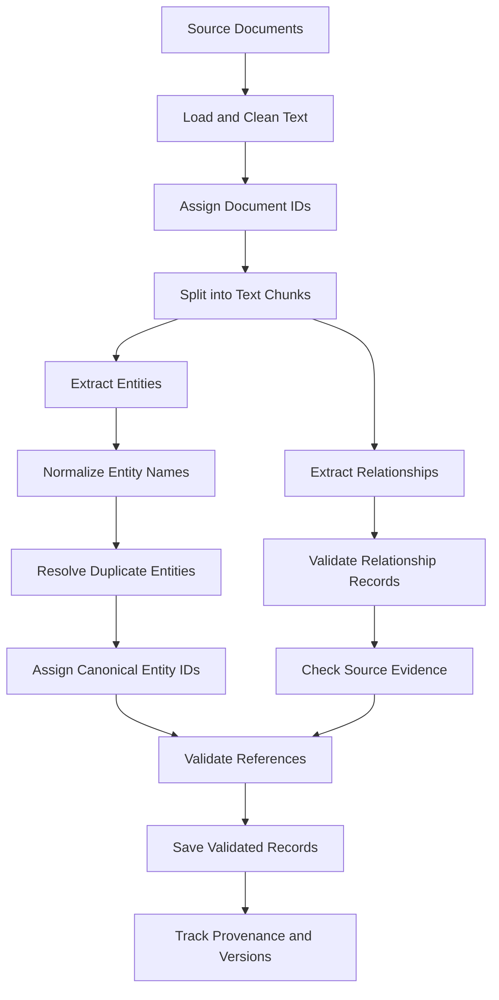

# Lesson 16: GraphRAG Document Processing and Graph Extraction

## 1. Definition

GraphRAG document processing converts unstructured text into structured information that can be used to build or update a graph-based RAG system.

Documents contain information in the form of paragraphs, sentences, tables, and other text. To process this information programmatically, we identify entities, extract relationships between them, validate the extracted data, resolve duplicate mentions, and preserve the original source evidence.

For example, consider this document:

"Alice develops a RAG application using Python. The application stores document embeddings in ChromaDB."

The extraction process can identify:

- Alice — PERSON
- RAG application — SOFTWARE_SYSTEM
- Python — PROGRAMMING_LANGUAGE
- ChromaDB — DATABASE

It can also identify relationships:

- Alice WORKS_ON RAG application.
- RAG application USES Python.
- RAG application USES ChromaDB.

Each extracted relationship should retain a reference to the document and the supporting passage.

The goal is to transform text into reliable, validated, traceable structured data.

## 2. Why It Matters

Document processing and extraction are important because the quality of the extracted information directly affects the quality of the resulting graph.

### 2.1 Convert unstructured text into structured data

A document contains sentences written for humans. Entity and relationship extraction converts relevant information into a consistent format that Python programs can process.

### 2.2 Preserve relationships between concepts

Traditional document processing often focuses on individual passages. Relationship extraction also identifies how concepts are connected.

For example:

- Python is used by an application.
- An application stores embeddings.
- Embeddings represent document chunks.

These connections provide structured information about the source material.

### 2.3 Reduce duplicate entities

The same entity may appear under different names.

For example:

- International Business Machines
- IBM

Entity resolution helps determine whether these mentions refer to the same organization.

Incorrect merging can create false relationships, so matching must be based on evidence rather than name similarity alone.

### 2.4 Improve traceability

Every extracted entity and relationship should be traceable to its source document and, where possible, the exact supporting passage.

This allows developers to investigate errors and verify whether the extracted information is supported by the original text.

### 2.5 Support reliable data updates

When a source document changes, the application should be able to identify which extracted records came from that document and update them appropriately.

Without source tracking, outdated relationships may remain in the graph even after the original information changes.

## 3. Key Concepts

### 3.1 Document preparation

Document preparation involves loading source files and converting them into clean text.

Common preparation tasks include:

- Removing unnecessary whitespace.
- Normalizing line endings.
- Extracting text from PDFs and HTML pages.
- Handling encoding issues.
- Preserving headings and useful document structure.
- Assigning a stable document ID.
- Recording source metadata.

Example:

```python
def clean_text(text: str) -> str:
    lines = [line.strip() for line in text.splitlines()]
    return "\n".join(line for line in lines if line)
```

Cleaning should not remove meaningful content such as negations, dates, identifiers, or technical terms.

### 3.2 Text chunking

Text chunking divides a long document into smaller passages.

Each passage is processed independently or as part of a controlled batch.

For example:

Document:
"Alice develops a RAG application. It uses Python and ChromaDB."

Possible chunks:

- Chunk 1: "Alice develops a RAG application."
- Chunk 2: "It uses Python and ChromaDB."

Chunking helps manage model context limits and makes source evidence easier to locate.

However, chunks that are too small may separate a relationship from the context needed to understand it.

Important chunking considerations:

- Chunk size.
- Chunk overlap.
- Sentence and paragraph boundaries.
- Document headings.
- Stable chunk IDs.
- Source document references.

A chunk should retain enough context to support accurate extraction.

### 3.3 Entity extraction

Entity extraction identifies important people, organizations, technologies, locations, products, events, and other concepts in text.

Example:

Input:

"Alice uses Python to build a RAG application."

Output:

```json
{
  "entities": [
    {
      "name": "Alice",
      "type": "PERSON"
    },
    {
      "name": "Python",
      "type": "PROGRAMMING_LANGUAGE"
    },
    {
      "name": "RAG application",
      "type": "SOFTWARE_SYSTEM"
    }
  ]
}
```

The entity types depend on the application.

A technical documentation system may recognize programming languages, frameworks, databases, and software systems. A business application may instead recognize customers, products, companies, and transactions.

A consistent entity schema helps prevent the same concept from being assigned different types in different documents.

### 3.4 Relationship extraction

Relationship extraction identifies how two entities are connected in a source passage.

Example:

Input:

"Alice develops an application using Python."

Output:

```json
{
  "relationships": [
    {
      "source": "Alice",
      "target": "Application",
      "type": "DEVELOPS"
    },
    {
      "source": "Application",
      "target": "Python",
      "type": "USES"
    }
  ]
}
```

Relationship names should follow a predefined schema.

Examples of relationship types:

- WORKS_FOR
- WORKS_ON
- USES
- DEVELOPED_BY
- STORES
- LOCATED_IN
- CREATED_BY
- DEPENDS_ON

Choose relationship names that match the application's domain.

Do not assume that two entities are related simply because they appear in the same document. The relationship should be supported by the passage.

### 3.5 Entity descriptions and properties

An entity can have properties that describe it.

For example:

```json
{
  "name": "Python",
  "type": "PROGRAMMING_LANGUAGE",
  "properties": {
    "category": "Programming",
    "source": "document_001"
  }
}
```

Properties may include:

- Name.
- Type.
- Description.
- External identifier.
- Creation date.
- Source document IDs.
- Confidence score.
- Domain-specific attributes.

Only include properties that are useful and supported by the source material.

### 3.6 Entity resolution

Entity resolution determines whether different mentions represent the same real-world entity.

Example:

```text
International Business Machines
IBM
I.B.M.
```

These may refer to the same organization.

A basic resolution process can use:

1. Text normalization.
2. Exact name matching.
3. Known aliases.
4. External identifiers.
5. Contextual information.
6. Manual review for uncertain matches.

For example, two mentions named "Apple" might refer to the technology company or the fruit.

Name similarity alone cannot reliably resolve this ambiguity.

A safe entity-resolution process should preserve distinct entities when the evidence is insufficient.

### 3.7 Canonical entity IDs

A canonical entity ID is a stable identifier assigned to an entity.

Example:

```json
{
  "entity_id": "org_001",
  "canonical_name": "International Business Machines",
  "aliases": [
    "IBM",
    "I.B.M."
  ],
  "type": "ORGANIZATION"
}
```

Relationships should reference entity IDs instead of relying only on display names.

This prevents spelling differences from creating unnecessary duplicate records.

A production system should use deterministic IDs or a persistent ID registry so that the same entity keeps its identity across processing runs.

### 3.8 Provenance and evidence

Provenance records where extracted information originated.

For a relationship, provenance can include:

- Source document ID.
- Chunk ID.
- Supporting text.
- Extraction method.
- Extraction timestamp.
- Confidence score.
- Source version.

Example:

```json
{
  "source": "alice",
  "target": "python",
  "type": "USES",
  "document_id": "doc_001",
  "chunk_id": "doc_001_chunk_001",
  "evidence": "Alice uses Python to build the application."
}
```

Evidence is important because extraction models can generate incorrect or unsupported relationships.

Keeping the original passage makes verification possible.

### 3.9 Schema validation

Schema validation checks whether extracted data follows the expected structure.

For example, a relationship might require:

- A non-empty source ID.
- A non-empty target ID.
- A permitted relationship type.
- A valid document ID.
- A supporting passage.

Invalid records should be rejected, corrected, or placed in a review queue.

Valid JSON alone does not guarantee that the information is factually correct.

### 3.10 Confidence and uncertainty

An extraction model may provide a confidence estimate, but the score is not automatically a calibrated probability of correctness.

Confidence can be used to prioritize human review.

For example:

- High confidence: accept for further automated checks.
- Medium confidence: verify against the source passage.
- Low confidence: reject or send for manual review.

Even high-confidence extractions should undergo basic schema and evidence validation.

### 3.11 Incremental document updates

An incremental update processes documents that have changed instead of reprocessing the entire dataset unnecessarily.

A document-processing system can maintain:

- Document IDs.
- Content hashes.
- Processing timestamps.
- Extraction versions.
- Entity and relationship provenance.

If a document's content hash changes, the system can identify it for reprocessing.

Records supported only by the previous version must be reconsidered. A relationship must not remain merely because it was extracted during an earlier run.

## 4. Architecture

### 4.1 Document processing and extraction pipeline

The following diagram covers the extraction stage without including downstream retrieval, community detection, or summary generation.



### 4.2 Explanation of the pipeline

**Step 1: Load and clean documents**

Read the original documents and normalize their text without losing important meaning.

**Step 2: Assign document IDs**

Assign stable identifiers so every extracted record can be traced to its source.

**Step 3: Split documents into chunks**

Create manageable passages and preserve their document IDs and positions.

**Step 4: Extract entities and relationships**

Use rules, NLP models, or an LLM to identify entities and the relationships explicitly supported by the text.

**Step 5: Normalize and resolve entities**

Standardize formatting, identify known aliases, and assign canonical IDs when there is sufficient evidence.

**Step 6: Validate extracted records**

Check required fields, permitted types, valid references, and source evidence.

**Step 7: Save records and provenance**

Persist accepted entities and relationships together with their source references and version information.

### 4.3 Extraction approaches

There are several ways to extract structured information from text.

#### Rule-based extraction

Uses regular expressions, dictionaries, and predefined patterns.

Advantages:
- Fast.
- Predictable.
- Easy to test.
- Useful for structured documents.

Limitations:
- Difficult to generalize to varied language.
- May miss relationships expressed in unexpected ways.

#### NLP-based extraction

Uses natural language processing libraries and trained models to identify entities or relationships.

Advantages:
- Can handle common language patterns.
- May be cheaper than calling an LLM for every passage.

Limitations:
- Accuracy depends on the model and domain.
- Domain-specific entities may require custom models or rules.

#### LLM-based extraction

Prompts an LLM to return structured entities and relationships.

Advantages:
- Can interpret a wider variety of sentences.
- Can follow domain-specific instructions.
- Can produce descriptions and evidence fields.

Limitations:
- May hallucinate facts.
- May return malformed output.
- Can be expensive or slow at scale.
- Requires validation and evaluation.

A practical system can combine these methods rather than relying on only one.

## 5. Python Implementation

This exercise implements a small, local extraction pipeline using Python, Pydantic, and NetworkX.

It demonstrates:

- Preparing source documents.
- Splitting documents into chunks.
- Extracting entities and relationships using deterministic rules.
- Validating structured records.
- Resolving explicitly defined aliases.
- Assigning canonical IDs.
- Preserving source evidence.
- Checking relationship references.
- Saving and reloading extracted records.
- Updating records after a source document changes.

Important: This is a working educational example, not a general-purpose NLP or LLM extractor. The extraction rules are intentionally limited so their behavior can be tested and understood. In a real project, the extraction functions can be replaced with an LLM or NLP model while keeping the validation and provenance layers.

### 5.1 Install dependencies

Activate your Python virtual environment and install the required libraries:

```bash
pip install pydantic networkx
```

Python 3.10 or later is recommended.

### 5.2 Create the example project

Suggested folder structure:

```text
rag-graphrag-learning/
├── data/
│   └── sample_documents/
│       ├── document_001.txt
│       └── document_002.txt
├── notes/
│   └── 16-graphrag-indexing.md
└── Practical_exercise/
    └── document_extraction_16.py
```

The program below is self-contained and creates its sample input files automatically.

Save it as:

`Practical_exercise/document_extraction_16.py`

### 5.3 Complete Python implementation

```python
import hashlib
import json
import re
from pathlib import Path

import networkx as nx
from pydantic import BaseModel, ConfigDict, Field, ValidationError


BASE_DIR = Path(__file__).resolve().parent.parent

DATA_DIR = BASE_DIR / "data" / "sample_documents"
OUTPUT_DIR = BASE_DIR / "data" / "processed"

DOCUMENTS_PATH = OUTPUT_DIR / "documents.json"
ENTITIES_PATH = OUTPUT_DIR / "entities.json"
RELATIONSHIPS_PATH = OUTPUT_DIR / "relationships.json"

CHUNK_SIZE = 45
CHUNK_OVERLAP = 8


# =========================================================
# 1. DATA SCHEMAS
# =========================================================

class Document(BaseModel):
    model_config = ConfigDict(extra="forbid")

    document_id: str = Field(min_length=1)
    text: str = Field(min_length=1)
    content_hash: str = Field(min_length=1)


class TextChunk(BaseModel):
    model_config = ConfigDict(extra="forbid")

    chunk_id: str = Field(min_length=1)
    document_id: str = Field(min_length=1)
    text: str = Field(min_length=1)
    start_char: int = Field(ge=0)
    end_char: int = Field(gt=0)


class Entity(BaseModel):
    model_config = ConfigDict(extra="forbid")

    entity_id: str = Field(min_length=1)
    canonical_name: str = Field(min_length=1)
    entity_type: str = Field(min_length=1)
    aliases: list[str] = Field(default_factory=list)
    source_document_ids: list[str] = Field(default_factory=list)


class Relationship(BaseModel):
    model_config = ConfigDict(extra="forbid")

    source_id: str = Field(min_length=1)
    target_id: str = Field(min_length=1)
    relationship_type: str = Field(min_length=1)
    document_id: str = Field(min_length=1)
    chunk_id: str = Field(min_length=1)
    evidence: str = Field(min_length=1)
    confidence: float = Field(ge=0.0, le=1.0)


# =========================================================
# 2. ENTITY AND RELATIONSHIP SCHEMAS
# =========================================================

# Only these entity types and relationship types are accepted.

ENTITY_TYPES = {
    "PERSON",
    "TECHNOLOGY",
    "PROGRAMMING_LANGUAGE",
    "DATABASE",
    "SOFTWARE_SYSTEM",
}

RELATIONSHIP_TYPES = {
    "WORKS_ON",
    "USES",
    "DEVELOPS",
}


# These aliases are explicit educational examples.
# Do not infer that arbitrary similar names are identical.

ALIASES = {
    "rag application": "RAG application",
    "the rag application": "RAG application",
    "python": "Python",
    "chromadb": "ChromaDB",
    "alice": "Alice",
}


# =========================================================
# 3. SAMPLE DOCUMENTS
# =========================================================

def create_sample_documents() -> None:
    DATA_DIR.mkdir(parents=True, exist_ok=True)

    samples = {
        "document_001.txt": (
            "Alice develops a RAG application using Python. "
            "The RAG application uses ChromaDB."
        ),
        "document_002.txt": (
            "Alice works on the RAG application. "
            "The application uses Python."
        ),
    }

    for filename, text in samples.items():
        path = DATA_DIR / filename

        # Create sample files only when they do not exist.
        # Existing files are not overwritten.
        if not path.exists():
            path.write_text(text, encoding="utf-8")


# =========================================================
# 4. DOCUMENT LOADING AND CLEANING
# =========================================================

def clean_text(text: str) -> str:
    """Normalize whitespace while preserving sentence boundaries."""

    text = text.replace("\r\n", "\n").replace("\r", "\n")
    text = re.sub(r"[ \t]+", " ", text)
    text = re.sub(r"\n{3,}", "\n\n", text)

    return text.strip()


def calculate_hash(text: str) -> str:
    """Return a stable hash of normalized document content."""

    return hashlib.sha256(
        text.encode("utf-8")
    ).hexdigest()


def load_documents() -> list[Document]:
    documents = []

    for path in sorted(DATA_DIR.glob("*.txt")):
        raw_text = path.read_text(encoding="utf-8")
        text = clean_text(raw_text)

        if not text:
            continue

        document = Document(
            document_id=path.stem,
            text=text,
            content_hash=calculate_hash(text),
        )

        documents.append(document)

    return documents


# =========================================================
# 5. CHUNKING
# =========================================================

def split_into_chunks(
    document: Document,
    chunk_size: int = CHUNK_SIZE,
    overlap: int = CHUNK_OVERLAP,
) -> list[TextChunk]:
    """
    Split a document into overlapping character-based chunks.

    This is a simple educational splitter. Production systems
    should consider sentence and paragraph boundaries.
    """

    if chunk_size <= 0:
        raise ValueError("chunk_size must be positive")

    if overlap < 0 or overlap >= chunk_size:
        raise ValueError(
            "overlap must be >= 0 and smaller than chunk_size"
        )

    text = document.text
    chunks = []

    start = 0
    index = 1

    while start < len(text):
        end = min(start + chunk_size, len(text))

        # Avoid ending in the middle of a word when possible.
        if end < len(text):
            space = text.rfind(" ", start, end)

            if space > start:
                end = space

        chunk_text = text[start:end].strip()

        if chunk_text:
            # Find the actual chunk location in the original text.
            actual_start = text.find(chunk_text, start)
            actual_end = actual_start + len(chunk_text)

            chunk = TextChunk(
                chunk_id=f"{document.document_id}_chunk_{index:03d}",
                document_id=document.document_id,
                text=chunk_text,
                start_char=actual_start,
                end_char=actual_end,
            )

            chunks.append(chunk)
            index += 1

        if end >= len(text):
            break

        start = max(end - overlap, start + 1)

    return chunks


# =========================================================
# 6. ENTITY NORMALIZATION
# =========================================================

def normalize_entity_name(name: str) -> str:
    """
    Normalize only explicitly supported aliases.

    Unknown names retain their cleaned display form.
    """

    cleaned = re.sub(r"\s+", " ", name).strip()
    key = cleaned.casefold()

    return ALIASES.get(key, cleaned)


def make_entity_id(name: str, entity_type: str) -> str:
    """
    Generate a deterministic ID from a canonical name and type.

    A persistent registry may be preferable in production when
    canonical names or entity classifications can change.
    """

    key = f"{entity_type}:{name.casefold()}"

    digest = hashlib.sha256(
        key.encode("utf-8")
    ).hexdigest()[:12]

    return f"ent_{digest}"


# =========================================================
# 7. ENTITY EXTRACTION
# =========================================================

def extract_entities(
    chunk: TextChunk,
) -> list[dict]:
    """
    Demonstration extractor for the controlled sample domain.

    Replace this function with a domain-specific NLP or LLM
    extractor for general documents.
    """

    text = chunk.text
    found = []

    # Explicit entity patterns for the example dataset.
    patterns = [
        (r"\bAlice\b", "PERSON"),
        (r"\bRAG application\b", "SOFTWARE_SYSTEM"),
        (r"\bPython\b", "PROGRAMMING_LANGUAGE"),
        (r"\bChromaDB\b", "DATABASE"),
    ]

    for pattern, entity_type in patterns:
        for match in re.finditer(pattern, text, re.IGNORECASE):
            name = normalize_entity_name(match.group(0))

            found.append({
                "name": name,
                "type": entity_type,
                "document_id": chunk.document_id,
                "chunk_id": chunk.chunk_id,
                "evidence": text,
            })

    return found


# =========================================================
# 8. RELATIONSHIP EXTRACTION
# =========================================================

def extract_relationships(
    chunk: TextChunk,
) -> list[dict]:
    """
    Extract a small set of explicitly defined sentence patterns.

    These rules are not a general natural-language parser.
    """

    results = []

    sentences = re.split(
        r"(?<=[.!?])\s+",
        chunk.text,
    )

    for sentence in sentences:
        sentence = sentence.strip()

        if not sentence:
            continue

        # Pattern 1:
        # Alice develops a RAG application.
        if re.search(
            r"\bAlice\s+develops?\s+(?:a\s+)?RAG application\b",
            sentence,
            re.IGNORECASE,
        ):
            results.append({
                "source_name": "Alice",
                "source_type": "PERSON",
                "target_name": "RAG application",
                "target_type": "SOFTWARE_SYSTEM",
                "relationship_type": "DEVELOPS",
                "evidence": sentence,
            })

        # Pattern 2:
        # Alice works on a RAG application.
        if re.search(
            r"\bAlice\s+works\s+on\s+(?:the\s+)?RAG application\b",
            sentence,
            re.IGNORECASE,
        ):
            results.append({
                "source_name": "Alice",
                "source_type": "PERSON",
                "target_name": "RAG application",
                "target_type": "SOFTWARE_SYSTEM",
                "relationship_type": "WORKS_ON",
                "evidence": sentence,
            })

        # Pattern 3:
        # A RAG application uses Python or ChromaDB.
        if re.search(
            r"\bRAG application\s+uses\s+(?:the\s+)?"
            r"(?:Python|ChromaDB)\b",
            sentence,
            re.IGNORECASE,
        ):
            target_match = re.search(
                r"\b(Python|ChromaDB)\b",
                sentence,
                re.IGNORECASE,
            )

            if target_match:
                target = normalize_entity_name(
                    target_match.group(1)
                )

                target_type = (
                    "PROGRAMMING_LANGUAGE"
                    if target == "Python"
                    else "DATABASE"
                )

                results.append({
                    "source_name": "RAG application",
                    "source_type": "SOFTWARE_SYSTEM",
                    "target_name": target,
                    "target_type": target_type,
                    "relationship_type": "USES",
                    "evidence": sentence,
                })

        # Pattern 4:
        # The application uses Python.
        # Resolve "the application" from the known sample context.
        if re.search(
            r"\bthe application\s+uses\s+(?:the\s+)?Python\b",
            sentence,
            re.IGNORECASE,
        ):
            results.append({
                "source_name": "RAG application",
                "source_type": "SOFTWARE_SYSTEM",
                "target_name": "Python",
                "target_type": "PROGRAMMING_LANGUAGE",
                "relationship_type": "USES",
                "evidence": sentence,
            })

    # Deduplicate exact pattern outputs within this chunk.
    unique = {}
    for item in results:
        key = (
            item["source_name"],
            item["target_name"],
            item["relationship_type"],
            item["evidence"],
        )
        unique[key] = item

    return list(unique.values())


# =========================================================
# 9. VALIDATE AND MERGE ENTITIES
# =========================================================

def build_entity_registry(
    chunks: list[TextChunk],
) -> dict[str, Entity]:
    """
    Merge repeated entity mentions using canonical name and type.
    """

    registry = {}

    for chunk in chunks:
        for item in extract_entities(chunk):
            name = item["name"]
            entity_type = item["type"]

            if entity_type not in ENTITY_TYPES:
                raise ValueError(
                    f"Unsupported entity type: {entity_type}"
                )

            entity_id = make_entity_id(name, entity_type)

            if entity_id not in registry:
                registry[entity_id] = Entity(
                    entity_id=entity_id,
                    canonical_name=name,
                    entity_type=entity_type,
                    aliases=[],
                    source_document_ids=[],
                )

            entity = registry[entity_id]

            if chunk.document_id not in entity.source_document_ids:
                entity.source_document_ids.append(
                    chunk.document_id
                )

    return registry


# =========================================================
# 10. VALIDATE RELATIONSHIPS AND EVIDENCE
# =========================================================

def build_relationship_records(
    chunks: list[TextChunk],
    entities: dict[str, Entity],
) -> list[Relationship]:
    records = []

    entity_lookup = {
        (
            entity.canonical_name.casefold(),
            entity.entity_type,
        ): entity.entity_id
        for entity in entities.values()
    }

    seen = set()

    for chunk in chunks:
        for item in extract_relationships(chunk):
            relationship_type = item["relationship_type"]

            if relationship_type not in RELATIONSHIP_TYPES:
                raise ValueError(
                    f"Unsupported relationship type: "
                    f"{relationship_type}"
                )

            source_key = (
                item["source_name"].casefold(),
                item["source_type"],
            )

            target_key = (
                item["target_name"].casefold(),
                item["target_type"],
            )

            if source_key not in entity_lookup:
                raise ValueError(
                    f"Missing source entity: {source_key}"
                )

            if target_key not in entity_lookup:
                raise ValueError(
                    f"Missing target entity: {target_key}"
                )

            source_id = entity_lookup[source_key]
            target_id = entity_lookup[target_key]

            # Verify that the supporting sentence contains both
            # entity mentions, including supported alias forms.
            evidence = item["evidence"]

            source_present = (
                item["source_name"].casefold() in evidence.casefold()
            )

            target_present = (
                item["target_name"].casefold() in evidence.casefold()
            )

            # For this educational example, the evidence must
            # contain both canonical names explicitly.
            # Pronoun-based relationships are handled separately
            # by the specific pattern above and should be reviewed
            # more carefully in a production extractor.
            if not source_present or not target_present:
                continue

            record = Relationship(
                source_id=source_id,
                target_id=target_id,
                relationship_type=relationship_type,
                document_id=chunk.document_id,
                chunk_id=chunk.chunk_id,
                evidence=evidence,
                confidence=1.0,
            )

            key = (
                record.source_id,
                record.target_id,
                record.relationship_type,
                record.document_id,
                record.chunk_id,
                record.evidence,
            )

            if key not in seen:
                records.append(record)
                seen.add(key)

    return records


# =========================================================
# 11. CROSS-RECORD VALIDATION
# =========================================================

def validate_records(
    documents: list[Document],
    chunks: list[TextChunk],
    entities: dict[str, Entity],
    relationships: list[Relationship],
) -> None:
    document_ids = {
        document.document_id
        for document in documents
    }

    chunk_lookup = {
        chunk.chunk_id: chunk
        for chunk in chunks
    }

    entity_ids = set(entities)

    for entity in entities.values():
        if entity.entity_type not in ENTITY_TYPES:
            raise ValueError("Invalid entity type")

        for document_id in entity.source_document_ids:
            if document_id not in document_ids:
                raise ValueError(
                    f"Unknown entity source document: {document_id}"
                )

    for relationship in relationships:
        if relationship.relationship_type not in RELATIONSHIP_TYPES:
            raise ValueError("Invalid relationship type")

        if relationship.source_id not in entity_ids:
            raise ValueError("Unknown source entity ID")

        if relationship.target_id not in entity_ids:
            raise ValueError("Unknown target entity ID")

        if relationship.document_id not in document_ids:
            raise ValueError("Unknown source document ID")

        if relationship.chunk_id not in chunk_lookup:
            raise ValueError("Unknown source chunk ID")

        chunk = chunk_lookup[relationship.chunk_id]

        if chunk.document_id != relationship.document_id:
            raise ValueError(
                "Chunk and document provenance do not match"
            )

        if relationship.evidence not in chunk.text:
            raise ValueError(
                "Relationship evidence is not present in its chunk"
            )


# =========================================================
# 12. BUILD A GRAPH FROM VALIDATED RECORDS
# =========================================================

def build_graph(
    entities: dict[str, Entity],
    relationships: list[Relationship],
) -> nx.MultiDiGraph:
    """
    Build a directed graph while retaining separate relationship
    records when they have different provenance.
    """

    graph = nx.MultiDiGraph()

    for entity in entities.values():
        graph.add_node(
            entity.entity_id,
            name=entity.canonical_name,
            entity_type=entity.entity_type,
        )

    for relationship in relationships:
        graph.add_edge(
            relationship.source_id,
            relationship.target_id,
            key=(
                relationship.document_id,
                relationship.chunk_id,
                relationship.relationship_type,
            ),
            relationship_type=relationship.relationship_type,
            document_id=relationship.document_id,
            chunk_id=relationship.chunk_id,
            evidence=relationship.evidence,
            confidence=relationship.confidence,
        )

    return graph


# =========================================================
# 13. SAVE AND LOAD JSON
# =========================================================

def save_json(path: Path, value) -> None:
    path.parent.mkdir(parents=True, exist_ok=True)

    temporary_path = path.with_suffix(
        path.suffix + ".tmp"
    )

    temporary_path.write_text(
        json.dumps(
            value,
            indent=2,
            ensure_ascii=False,
        ),
        encoding="utf-8",
    )

    temporary_path.replace(path)


def save_records(
    documents: list[Document],
    entities: dict[str, Entity],
    relationships: list[Relationship],
) -> None:
    save_json(
        DOCUMENTS_PATH,
        [item.model_dump() for item in documents],
    )

    save_json(
        ENTITIES_PATH,
        [item.model_dump() for item in entities.values()],
    )

    save_json(
        RELATIONSHIPS_PATH,
        [item.model_dump() for item in relationships],
    )


def load_and_validate_saved_records():
    documents = [
        Document.model_validate(item)
        for item in json.loads(
            DOCUMENTS_PATH.read_text(encoding="utf-8")
        )
    ]

    entities_list = [
        Entity.model_validate(item)
        for item in json.loads(
            ENTITIES_PATH.read_text(encoding="utf-8")
        )
    ]

    relationships = [
        Relationship.model_validate(item)
        for item in json.loads(
            RELATIONSHIPS_PATH.read_text(encoding="utf-8")
        )
    ]

    entities = {
        entity.entity_id: entity
        for entity in entities_list
    }

    return documents, entities, relationships


# =========================================================
# 14. MAIN PIPELINE
# =========================================================

def main() -> None:
    create_sample_documents()

    documents = load_documents()

    if not documents:
        raise RuntimeError("No source documents were loaded")

    chunks = []

    for document in documents:
        chunks.extend(split_into_chunks(document))

    entities = build_entity_registry(chunks)

    relationships = build_relationship_records(
        chunks,
        entities,
    )

    validate_records(
        documents,
        chunks,
        entities,
        relationships,
    )

    graph = build_graph(
        entities,
        relationships,
    )

    save_records(
        documents,
        entities,
        relationships,
    )

    # Reload and validate the serialized output.
    loaded_documents, loaded_entities, loaded_relationships = (
        load_and_validate_saved_records()
    )

    # Validate references again after loading.
    validate_records(
        loaded_documents,
        chunks,
        loaded_entities,
        loaded_relationships,
    )

    print("\nDOCUMENT PROCESSING COMPLETE")
    print("-" * 40)

    print(f"Documents: {len(documents)}")
    print(f"Chunks: {len(chunks)}")
    print(f"Entities: {len(entities)}")
    print(f"Relationships: {len(relationships)}")
    print(f"Graph nodes: {graph.number_of_nodes()}")
    print(f"Graph edges: {graph.number_of_edges()}")

    print("\nEXTRACTED ENTITIES")

    for entity in entities.values():
        print(
            f"{entity.canonical_name} "
            f"({entity.entity_type}) "
            f"[{entity.entity_id}]"
        )

    print("\nEXTRACTED RELATIONSHIPS")

    for relationship in relationships:
        source = entities[
            relationship.source_id
        ].canonical_name

        target = entities[
            relationship.target_id
        ].canonical_name

        print(
            f"{source} "
            f"--{relationship.relationship_type}--> "
            f"{target}"
        )

        print(
            f"  Evidence: {relationship.evidence}"
        )

        print(
            f"  Source: {relationship.document_id}, "
            f"{relationship.chunk_id}"
        )

    print("\nSAVED FILES")
    print(DOCUMENTS_PATH)
    print(ENTITIES_PATH)
    print(RELATIONSHIPS_PATH)

    print("\nReload and validation successful.")


if __name__ == "__main__":
    try:
        main()
    except (ValueError, ValidationError) as exc:
        raise SystemExit(
            f"Validation failed: {exc}"
        ) from exc
```

### 5.4 Run the program

From your project root:

```bash
python Practical_exercise/document_extraction_16.py
```

The script creates two sample documents and writes the processed output under:

```text
data/processed/
├── documents.json
├── entities.json
└── relationships.json
```

The exact number of chunks and extracted relationships depends on the chunk boundaries and the example text. The printed counts show what the current implementation produced.

**Important implementation note:** This example deliberately uses a small set of extraction patterns. Its pronoun handling and evidence checks are not suitable for arbitrary documents. Before applying it to real data, replace the rules with a more robust extractor and add explicit sentence-level provenance and entity-resolution checks.

### 5.5 Inspect the output

The entities file contains canonical records with source document IDs.

Example:

```json
{
  "entity_id": "ent_example",
  "canonical_name": "Python",
  "entity_type": "PROGRAMMING_LANGUAGE",
  "aliases": [],
  "source_document_ids": [
    "document_001",
    "document_002"
  ]
}
```

The relationship file contains source and target IDs, the relationship type, evidence, and provenance.

Example:

```json
{
  "source_id": "ent_application",
  "target_id": "ent_python",
  "relationship_type": "USES",
  "document_id": "document_001",
  "chunk_id": "document_001_chunk_001",
  "evidence": "The RAG application uses Python.",
  "confidence": 1.0
}
```

The IDs above are illustrative. The program generates deterministic IDs from entity names and types.

### 5.6 Replace rule-based extraction with an LLM

In a real system, an LLM can return structured records for each chunk.

A prompt might look like this:

```text
Extract entities and relationships from the supplied passage.

Rules:
1. Extract only information supported by the passage.
2. Use entity types from the approved schema.
3. Use relationship types from the approved schema.
4. Preserve the exact supporting sentence.
5. Do not invent entities or relationships.
6. Represent uncertain information explicitly.
7. Return valid JSON matching the required schema.

Entity types:
PERSON, ORGANIZATION, TECHNOLOGY, LOCATION

Relationship types:
WORKS_FOR, USES, LOCATED_IN

Passage:
{chunk_text}
```

The application should then:

1. Parse the returned JSON.
2. Validate it against a schema.
3. Check entity and relationship types.
4. Resolve entity references.
5. Verify the evidence against the source passage.
6. Store accepted records and provenance.
7. Log invalid records for review.

Structured output helps control the format, but it does not guarantee that the extraction is factually correct.

## 6. Practical Exercises

### Exercise 1: Extract entities from five documents

Create five short text files covering different topics.

For example:

- A person developing a Python application.
- A company using a database.
- A researcher working with embeddings.
- A team building a retrieval system.
- An application integrating two technologies.

Tasks:

1. Load all five documents.
2. Assign stable document IDs.
3. Extract entities from each document.
4. Assign a type to every entity.
5. Save the results as JSON.
6. Check that every entity has at least one valid source document.

Expected result:

A structured entity dataset containing entities from all five documents.

### Exercise 2: Define and validate a relationship schema

Create an approved set of relationship types.

Example:

```python
RELATIONSHIP_TYPES = {
    "USES",
    "DEVELOPS",
    "WORKS_FOR",
    "DEPENDS_ON",
}
```

Tasks:

1. Extract relationships from your documents.
2. Validate the relationship type.
3. Check that the source and target entities exist.
4. Reject records with missing IDs.
5. Retain the supporting passage for each accepted relationship.

Test the validator using an invalid relationship type such as `LIKES_BEST`.

Expected result:

Invalid records are rejected before they are added to the graph.

### Exercise 3: Resolve duplicate entity mentions

Create a dataset containing these names:

```text
International Business Machines
IBM
I.B.M.
```

Tasks:

1. Normalize whitespace and capitalization.
2. Create an explicit alias mapping.
3. Assign a canonical entity ID.
4. Merge the mentions only when the evidence supports a match.
5. Keep source document IDs for every mention.

Add a second entity named "Apple" with a different meaning.

Expected result:

Known aliases are merged, while ambiguous names are not automatically combined.

### Exercise 4: Preserve relationship provenance

Extract relationships from multiple documents.

For each relationship, save:

- Source entity ID.
- Target entity ID.
- Relationship type.
- Document ID.
- Chunk ID.
- Supporting evidence.

Tasks:

1. Inspect each relationship record.
2. Verify the referenced document and chunk.
3. Confirm that the evidence exists in the source chunk.
4. Remove a sentence from a document and observe how the evidence check behaves.

Expected result:

Each accepted relationship can be traced to its source passage.

### Exercise 5: Handle document updates

Modify one sample document after processing it.

Tasks:

1. Calculate the original content hash.
2. Change a sentence.
3. Calculate the new content hash.
4. Detect that the document has changed.
5. Re-extract the changed document.
6. Replace its previous extracted records without deleting records still supported by other documents.

Expected result:

The system detects the document update and avoids retaining obsolete relationships.

### Exercise 6: Compare extraction methods

Implement a small rule-based extractor and compare its output with an LLM-based extractor.

Use the same five documents for both.

Measure:

- Entity precision.
- Entity recall.
- Relationship precision.
- Relationship recall.
- Invalid output rate.
- Processing time.
- Estimated processing cost.

Expected result:

A comparison showing the strengths and weaknesses of each extraction approach.

## 7. Common Problems

### 7.1 Incorrect entity extraction

**Problem:** The extractor identifies ordinary words as entities or misses important technical terms.

**Solution:**

- Define the entity types in advance.
- Use domain-specific extraction rules.
- Provide clear instructions to the extraction model.
- Review a sample of extracted entities.
- Measure precision and recall against manually labeled examples.

### 7.2 Incorrect relationships

**Problem:** Two entities appear in the same paragraph, but the extractor creates a relationship that the source does not support.

**Solution:**

- Require explicit evidence.
- Use an approved relationship schema.
- Validate the source and target entities.
- Review relationships with uncertain evidence.
- Avoid assuming that co-occurrence proves a relationship.

### 7.3 Duplicate entities

**Problem:** The same entity is stored multiple times under different names.

**Solution:**

- Normalize names.
- Maintain explicit aliases.
- Use reliable external identifiers where available.
- Apply contextual checks before merging.
- Preserve all original mentions and source references.

### 7.4 Incorrect entity merging

**Problem:** Two different entities with similar names are merged.

**Solution:**

- Do not rely only on string similarity.
- Compare entity types and context.
- Use external IDs when available.
- Keep uncertain matches separate until reviewed.

### 7.5 Missing source evidence

**Problem:** A relationship is stored without a source passage.

**Solution:**

- Make document and chunk IDs required fields.
- Store the supporting text or a stable reference to it.
- Verify that the referenced source exists.
- Reject or flag records with missing provenance.

### 7.6 Invalid structured output

**Problem:** An LLM returns incomplete JSON, unexpected fields, or invalid types.

**Solution:**

- Use structured output or constrained JSON generation where supported.
- Validate the response using Pydantic or an equivalent schema validator.
- Retry only when appropriate.
- Log invalid responses.
- Never insert unvalidated records directly into persistent storage.

### 7.7 Chunk boundaries break relationships

**Problem:** A sentence refers to an entity introduced in a previous chunk.

**Solution:**

- Use sentence-aware chunking.
- Preserve headings and nearby context.
- Use controlled overlap.
- Resolve references only when the evidence is sufficient.
- Avoid automatically carrying assumptions across unrelated chunks.

### 7.8 Stale relationships after document updates

**Problem:** An old relationship remains after its supporting statement is removed.

**Solution:**

- Track the source document and version for each extraction.
- Reprocess changed documents.
- Replace or invalidate records supported only by the previous version.
- Preserve records that remain supported by other documents.

### 7.9 Repeated relationships

**Problem:** The same relationship is extracted multiple times.

**Solution:**

- Define a relationship identity rule.
- Deduplicate identical records when appropriate.
- Preserve separate provenance records when different documents independently support the relationship.

Do not discard source evidence simply because two relationships have the same endpoints.

### 7.10 High extraction cost

**Problem:** Processing a large corpus with an LLM becomes expensive or slow.

**Solution:**

- Process documents in batches.
- Avoid reprocessing unchanged documents.
- Use smaller models or NLP for suitable tasks.
- Apply caching carefully.
- Monitor token usage, latency, and validation failures.
- Reserve more capable models for difficult or ambiguous passages.

## 8. Evaluation

Evaluation determines whether the extracted data is accurate, complete, consistent, and traceable.

### 8.1 Entity precision

Precision measures how many extracted entities are correct.

Precision = Correctly extracted entities / Total extracted entities

High precision means fewer incorrect entities.

### 8.2 Entity recall

Recall measures how many of the expected entities were extracted.

Recall = Correctly extracted entities / Total expected entities

High recall means fewer missed entities.

### 8.3 Relationship precision

Relationship precision measures how many extracted relationships are correct.

Relationship precision = Correct relationships / Total extracted relationships

A relationship is correct only when its endpoints, type, direction, and supporting evidence match the expected result.

### 8.4 Relationship recall

Relationship recall measures how many of the expected relationships were extracted.

Relationship recall = Correct relationships / Total expected relationships

### 8.5 F1 score

The F1 score combines precision and recall.

F1 = 2 × (Precision × Recall) / (Precision + Recall)

It is useful when both false positives and missed extractions matter.

If precision and recall are both zero, define the reported F1 as zero rather than dividing by zero.

### 8.6 Entity-resolution accuracy

Evaluate whether mentions referring to the same real-world entity are correctly merged and whether distinct entities remain separate.

Measure:

- Correct merges.
- Incorrect merges.
- Missed merges.
- Unresolved mentions.

Incorrect merges deserve particular attention because they can introduce misleading relationships.

### 8.7 Provenance accuracy

Check whether every accepted relationship points to the correct document and passage.

Useful checks include:

- Every document ID exists.
- Every chunk ID exists.
- Each chunk belongs to the stated document.
- The supporting evidence appears in the source passage.
- The extracted relationship is supported by that evidence.

### 8.8 Automated validation tests

Add these checks to your Python program:

```python
def test_document_hash_changes():
    original = "Alice uses Python."
    updated = "Alice uses ChromaDB."

    assert calculate_hash(original) != calculate_hash(updated)


def test_alias_resolution():
    assert normalize_entity_name("ibm") == "ibm"
    assert normalize_entity_name("python") == "Python"


def test_entity_id_is_deterministic():
    first = make_entity_id(
        "Python",
        "PROGRAMMING_LANGUAGE",
    )

    second = make_entity_id(
        "Python",
        "PROGRAMMING_LANGUAGE",
    )

    assert first == second


def test_invalid_entity_type():
    try:
        Entity(
            entity_id="ent_test",
            canonical_name="Example",
            entity_type="UNKNOWN_TYPE",
        )
    except ValidationError:
        # Pydantic validates field types, but the allowed
        # entity-type set is enforced by application logic.
        pass
```

Note: The last test only demonstrates Pydantic's structural validation. It does not enforce membership in `ENTITY_TYPES` by itself. To reject unknown entity types during model construction, use a `Literal` field, an enum, or a custom validator. The application-level checks in the main pipeline enforce the approved set for extracted records.

Run your tests using:

```bash
pytest -v
```

For production-quality code, put these tests in a separate test file and add tests for relationship validation, alias collisions, missing evidence, and document updates.

### 8.9 Evaluation checklist

Before accepting the output, verify:

- [ ] All source documents have stable IDs.
- [ ] Chunks reference valid documents.
- [ ] Entity types follow the approved schema.
- [ ] Relationship types follow the approved schema.
- [ ] Source and target entity IDs exist.
- [ ] Evidence is traceable to the original source.
- [ ] Duplicate entities are handled correctly.
- [ ] Ambiguous names are not merged without sufficient evidence.
- [ ] Document changes can be detected.
- [ ] Obsolete extraction records can be removed or replaced.
- [ ] Evaluation metrics are measured against labeled examples.

## 9. Key Learnings

After completing this lesson, you should understand:

1. How to load, clean, and prepare source documents.
2. Why text chunking matters for extraction.
3. How entities and relationships can be extracted from passages.
4. Why a consistent schema is necessary.
5. How entity resolution reduces duplicate records.
6. Why canonical IDs are more reliable than display names.
7. How provenance connects extracted information to source evidence.
8. How Pydantic validates structured records.
9. How NetworkX can represent validated entities and relationships in Python.
10. How JSON can be used to persist extraction results.
11. How document hashes help detect changes.
12. How precision, recall, F1, and provenance checks measure extraction quality.

The main principle is that extracted information should be structured, validated, and supported by source evidence. A record should not be accepted merely because an extraction model produced it.

## 10. References

### Official documentation

1. **Microsoft GraphRAG documentation**

   https://github.com/microsoft/graphrag

   Useful for understanding the project's extraction pipeline, input formats, configuration, and implementation.

2. **Microsoft GraphRAG indexing methods**

   https://github.com/microsoft/graphrag/blob/main/docs/index/methods.md

   Describes entity extraction, relationship extraction, and alternative extraction approaches.

3. **Pydantic documentation**

   https://docs.pydantic.dev/latest/concepts/models/

   Explains schema-based data validation, model fields, and structured data handling.

4. **NetworkX documentation**

   https://networkx.org/documentation/stable/

   Explains graph data structures, nodes, edges, and graph operations in Python.

5. **Python JSON documentation**

   https://docs.python.org/3/library/json.html

   Explains reading, writing, and serializing JSON data.

6. **Python hashlib documentation**

   https://docs.python.org/3/library/hashlib.html

   Explains content hashing, including SHA-256, which can help detect document changes.

### Relevant research paper

7. **From Local to Global: A Graph RAG Approach to Query-Focused Summarization**

   https://arxiv.org/abs/2404.16130

   Introduces Microsoft's GraphRAG approach and explains why structured relationships extracted from source documents can support question answering over large document collections.

### Suggested study order

1. Understand document preparation and chunking.
2. Implement entity extraction.
3. Implement relationship extraction.
4. Add schema validation.
5. Add entity resolution and canonical IDs.
6. Preserve document and chunk provenance.
7. Implement document update detection.
8. Evaluate extraction quality with a labeled dataset.

