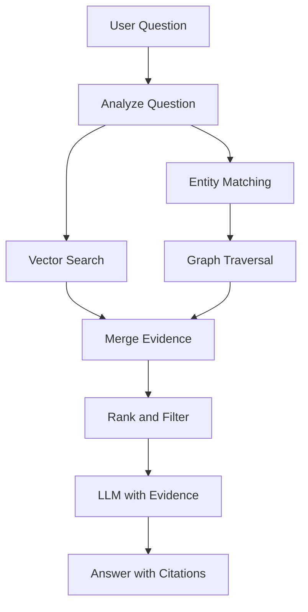

# Lesson 17: GraphRAG Retrieval Strategies

## 17.1 Definition

GraphRAG retrieval strategies are methods used to retrieve relevant information from documents and graph structures to answer user questions.

Traditional RAG mainly retrieves relevant text chunks using vector similarity or keyword search.

GraphRAG can also use relationships between entities to find connected information and answer questions that require multiple steps of reasoning.

For example, suppose documents contain the following information:

- Project Alpha uses FastAPI.
- FastAPI is a Python web framework.
- Project Alpha uses Chroma for vector storage.

Question:

"What technologies does Project Alpha use, and what is FastAPI used for?"

A simple vector search might retrieve the document mentioning Project Alpha and FastAPI.

A graph-based retrieval approach can connect:

Project Alpha → uses → FastAPI

FastAPI → is a → Python web framework

This helps retrieve evidence about both the technology and its purpose.

Common retrieval approaches include:

1. Local retrieval
2. Global retrieval
3. Hybrid graph and vector retrieval

Each approach is useful for different types of questions.

---

## 17.2 Why It Matters

Choosing the correct retrieval strategy helps an application find useful evidence before generating an answer.

Different questions require different retrieval methods.

### Example 1: Direct factual question

Question:

"What database does Project Alpha use?"

A vector search or direct entity lookup may be enough.

### Example 2: Relationship question

Question:

"How is Project Alpha connected to FastAPI?"

The system may need to retrieve the entities and follow their relationship.

### Example 3: Broad question

Question:

"What are the most common technical challenges discussed across these research reports?"

The system may need to combine information from many documents instead of retrieving only a few matching passages.

### Benefits

- Retrieves information connected through relationships.
- Helps answer multi-step questions.
- Supports questions involving multiple documents.
- Can combine structured relationships with original text evidence.
- Provides different retrieval approaches for different question types.

Important: GraphRAG is not automatically better than traditional RAG. For simple questions, ordinary vector retrieval may be faster, cheaper, and sufficient.

---

## 17.3 Key Concepts

### 1. Local Retrieval

Local retrieval focuses on a particular entity or a small connected part of a graph.

The system identifies entities related to the question and retrieves relevant connections and supporting text passages.

Example:

Question:

"What technologies does Project Alpha use?"

Relevant information:

- Project Alpha uses FastAPI.
- Project Alpha uses Chroma.
- FastAPI is a Python web framework.

The retrieval process focuses on Project Alpha and its nearby connections.

Use local retrieval when questions involve:

- A particular person or organization.
- A specific project or technology.
- Relationships between a small number of entities.
- Multi-hop questions about connected information.

A multi-hop question requires following more than one relationship to find an answer.

Example:

"Which programming language is used by the framework used in Project Alpha?"

Possible reasoning path:

Project Alpha → uses → FastAPI → written in → Python

The system must retrieve evidence from more than one connection.

### 2. Global Retrieval

Global retrieval focuses on broader patterns and themes across a large collection of information.

Instead of focusing on one entity, it aims to combine evidence from many documents.

Example:

Question:

"What are the main challenges reported across 100 research reports?"

The answer may require examining information from many reports.

Global retrieval is useful for:

- Summarizing themes across a document collection.
- Identifying recurring problems.
- Comparing findings across many reports.
- Answering broad analytical questions.

Global retrieval can be expensive because it may require processing large amounts of information.

Some GraphRAG systems use graph communities and their summaries to support global questions. Community detection and community summaries are separate topics and are not implemented in this lesson.

### 3. Hybrid Graph and Vector Retrieval

Hybrid graph and vector retrieval combines semantic text search with graph-based retrieval.

Vector retrieval finds text passages that are semantically related to the question.

Graph retrieval finds relevant entities and relationships.

The results are combined to provide useful evidence to the language model.

Example:

Question:

"How does the technology used by Project Alpha support its retrieval system?"

Possible process:

1. Search documents for passages related to Project Alpha and retrieval.
2. Identify entities such as Project Alpha, FastAPI, and Chroma.
3. Retrieve relevant relationships between those entities.
4. Combine the retrieved passages and relationships.
5. Rank and filter the evidence.
6. Generate an answer using the selected evidence.

Hybrid retrieval is useful when text similarity alone may miss important connections.

### 4. Entity Matching

Entity matching identifies entities mentioned in a question.

Example:

Question:

"What does FastAPI do in Project Alpha?"

Possible entities:

- FastAPI
- Project Alpha

The retrieval system can use these entities as starting points for graph exploration.

Entity matching can fail when names are ambiguous or written differently.

### 5. Graph Traversal

Graph traversal follows connections from one entity to another.

Example:

Project Alpha → uses → FastAPI

FastAPI → is a → Python web framework

A traversal starting from Project Alpha may discover FastAPI and then retrieve information about its purpose.

Traversal should be limited to relevant connections. Exploring too many connections can introduce unrelated information.

### 6. Evidence Ranking

A retrieval system may find many passages and relationships.

Evidence ranking helps prioritize the information most relevant to the question.

Possible ranking signals include:

- Semantic similarity to the question.
- Keyword relevance.
- Relationship relevance.
- Source quality.
- Evidence coverage.

The ranking method depends on the application.

### 7. Evidence Filtering

Evidence filtering removes irrelevant or low-quality results before they reach the language model.

For example, if a question concerns Project Alpha, a passage about an unrelated project should not be included simply because it contains similar words.

Filtering helps reduce noise and unsupported answers.

### 8. Retrieval Versus Generation

Retrieval and generation are separate stages.

Retrieval finds relevant evidence.

Generation uses that evidence to formulate an answer.

A language model cannot reliably compensate for missing or incorrect retrieved evidence.

Therefore, improving retrieval quality is an important part of building a reliable RAG application.

---

## 17.4 Architecture

A basic hybrid GraphRAG retrieval pipeline can be represented as follows:



### Architecture explanation

**Step 1: User Question**

The user submits a question.

**Step 2: Analyze Question**

The application determines what kind of information is needed.

**Step 3: Vector Search**

The system retrieves text passages that are semantically similar to the question.

**Step 4: Entity Matching**

The system identifies entities mentioned in the question.

**Step 5: Graph Traversal**

The system follows relevant entity relationships to retrieve connected evidence.

**Step 6: Merge Evidence**

The system combines the text passages and graph-derived evidence.

**Step 7: Rank and Filter**

The system removes irrelevant results and prioritizes useful evidence.

**Step 8: LLM with Evidence**

The language model receives the question and selected evidence.

**Step 9: Answer with Citations**

The application generates an answer and provides source references when available.

Note: This is a general hybrid retrieval architecture. Implementations may use different components or execution orders.

---

## 17.5 Python Implementation

This exercise implements a small, working example of hybrid retrieval.

It demonstrates:

- Vector similarity retrieval.
- Entity matching.
- Graph traversal.
- Combining retrieved evidence.
- Generating a simple evidence-based answer.
- Comparing vector-only and hybrid retrieval.

The example uses TF-IDF vectors from scikit-learn rather than a neural embedding model. This keeps the example lightweight and easy to run.

It uses a small in-memory graph represented by Python dictionaries. It does not require a graph database or an LLM API.

### Step 1: Install dependencies

Run:

```bash
pip install scikit-learn
```

### Step 2: Create the Python file

Create:

`Practical_exercise/graphrag_retrieval_17.py`

Copy the following code into the file.

```python
"""
Lesson 17: GraphRAG Retrieval Strategies

This example demonstrates:
1. Vector-based text retrieval.
2. Entity matching.
3. Graph traversal.
4. Hybrid retrieval.
5. A simple evidence-based answer.

This is a small educational example, not a production GraphRAG system.
"""

from sklearn.feature_extraction.text import TfidfVectorizer
from sklearn.metrics.pairwise import cosine_similarity


# ---------------------------------------------------------
# 1. SAMPLE DOCUMENTS
# ---------------------------------------------------------
# Each document contains a unique ID and its text.
# A real application could load these documents from files
# or retrieve them from a document database.

documents = [
    {
        "id": "doc1",
        "text": "Project Alpha uses FastAPI for its backend API.",
    },
    {
        "id": "doc2",
        "text": "FastAPI is a Python web framework used to build APIs.",
    },
    {
        "id": "doc3",
        "text": "Project Alpha uses Chroma for vector storage.",
    },
    {
        "id": "doc4",
        "text": "Chroma stores and searches vector embeddings.",
    },
    {
        "id": "doc5",
        "text": "Project Beta uses Django for its web application.",
    },
]


# ---------------------------------------------------------
# 2. SIMPLE KNOWLEDGE GRAPH
# ---------------------------------------------------------
# Each relationship contains:
# source entity -> relationship -> target entity
#
# This is a plain Python list, not a graph database.

edges = [
    ("Project Alpha", "uses", "FastAPI"),
    ("FastAPI", "is_a", "Python web framework"),
    ("Project Alpha", "uses", "Chroma"),
    ("Chroma", "used_for", "vector storage"),
    ("Project Beta", "uses", "Django"),
]


# ---------------------------------------------------------
# 3. PREPARE THE VECTOR RETRIEVER
# ---------------------------------------------------------
# TF-IDF converts the document texts into numerical vectors.
# Cosine similarity compares the question vector with
# the document vectors.
#
# Unlike a neural embedding model, TF-IDF does not fully
# understand semantic similarity.

document_texts = [
    document["text"]
    for document in documents
]

vectorizer = TfidfVectorizer()

document_vectors = vectorizer.fit_transform(document_texts)


# ---------------------------------------------------------
# 4. VECTOR SEARCH
# ---------------------------------------------------------
def vector_search(question: str, top_k: int = 3) -> list[dict]:
    """
    Retrieve documents with the highest TF-IDF cosine
    similarity to the question.
    """

    # Convert the question into a vector using the same
    # vectorizer that processed the documents.
    question_vector = vectorizer.transform([question])

    # Compare the question vector against all document vectors.
    scores = cosine_similarity(
        question_vector,
        document_vectors,
    )[0]

    # Sort document indexes by similarity, highest first.
    ranked_indexes = scores.argsort()[::-1]

    results = []

    for index in ranked_indexes:
        # Ignore documents with no matching terms.
        if scores[index] <= 0:
            continue

        results.append({
            "id": documents[index]["id"],
            "text": documents[index]["text"],
            "score": float(scores[index]),
        })

        # Stop after retrieving the requested number.
        if len(results) >= top_k:
            break

    return results


# ---------------------------------------------------------
# 5. ENTITY MATCHING
# ---------------------------------------------------------
def match_entities(question: str) -> list[str]:
    """
    Identify known entities mentioned in the question.

    This uses simple string matching.
    A production system may need entity linking or
    named-entity recognition.
    """

    question_lower = question.lower()

    # Extract entity names from graph edges.
    known_entities = set()

    for source, _, target in edges:
        known_entities.add(source)
        known_entities.add(target)

    # Match longer names first to reduce partial matches.
    matched_entities = []

    for entity in sorted(
        known_entities,
        key=len,
        reverse=True,
    ):
        if entity.lower() in question_lower:
            matched_entities.append(entity)

    return matched_entities


# ---------------------------------------------------------
# 6. GRAPH TRAVERSAL
# ---------------------------------------------------------
def graph_traversal(
    starting_entities: list[str],
    max_hops: int = 2,
) -> list[str]:
    """
    Retrieve graph relationships connected to the starting
    entities.

    max_hops limits how far the traversal can explore.

    This example follows relationships in their stored
    direction, from source to target.
    """

    # Keep track of entities already visited.
    visited = set(starting_entities)

    # The first frontier contains the starting entities.
    frontier = set(starting_entities)

    # Store the relationship statements found.
    retrieved_edges = []

    for _ in range(max_hops):
        next_frontier = set()

        for source, relation, target in edges:

            # Follow an outgoing relationship when its source
            # is in the current frontier.
            if source in frontier:
                statement = (
                    f"{source} --{relation}--> {target}"
                )

                if statement not in retrieved_edges:
                    retrieved_edges.append(statement)

                # Continue traversal from the target entity
                # if it has not already been visited.
                if target not in visited:
                    next_frontier.add(target)
                    visited.add(target)

        # Stop if no additional entities were discovered.
        if not next_frontier:
            break

        frontier = next_frontier

    return retrieved_edges


# ---------------------------------------------------------
# 7. HYBRID RETRIEVAL
# ---------------------------------------------------------
def hybrid_retrieval(
    question: str,
    top_k: int = 3,
    max_hops: int = 2,
) -> dict:
    """
    Combine vector search with entity matching and
    graph traversal.
    """

    # Retrieve relevant text passages.
    vector_results = vector_search(
        question,
        top_k=top_k,
    )

    # Identify entities mentioned in the question.
    entities = match_entities(question)

    # Retrieve relationships connected to those entities.
    graph_results = graph_traversal(
        entities,
        max_hops=max_hops,
    )

    return {
        "question": question,
        "matched_entities": entities,
        "vector_results": vector_results,
        "graph_results": graph_results,
    }


# ---------------------------------------------------------
# 8. SIMPLE EVIDENCE-BASED ANSWER
# ---------------------------------------------------------
def generate_answer(retrieval_result: dict) -> str:
    """
    Create a basic answer from the retrieved evidence.

    This function does not call an LLM. It demonstrates
    how retrieved evidence can be presented with source IDs.
    """

    lines = []

    # Include text evidence with document identifiers.
    for result in retrieval_result["vector_results"]:
        lines.append(
            f"[{result['id']}] {result['text']}"
        )

    # Include relevant graph relationships.
    for relationship in retrieval_result["graph_results"]:
        lines.append(
            f"[Graph evidence] {relationship}"
        )

    if not lines:
        return "No relevant evidence was retrieved."

    return "\n".join(lines)


# ---------------------------------------------------------
# 9. RUN THE EXAMPLE
# ---------------------------------------------------------
if __name__ == "__main__":

    question = (
        "What technologies does Project Alpha use, "
        "and what is FastAPI?"
    )

    # Run vector search separately.
    vector_results = vector_search(question)

    print("\nQUESTION")
    print(question)

    print("\nVECTOR-ONLY RESULTS")

    for result in vector_results:
        print(
            f"[{result['id']}] "
            f"score={result['score']:.3f} "
            f"text={result['text']}"
        )

    # Run the hybrid retrieval pipeline.
    hybrid_results = hybrid_retrieval(question)

    print("\nMATCHED ENTITIES")
    print(hybrid_results["matched_entities"])

    print("\nGRAPH RESULTS")

    for relationship in hybrid_results["graph_results"]:
        print(relationship)

    print("\nHYBRID EVIDENCE")

    answer = generate_answer(hybrid_results)
    print(answer)
```

### Step 3: Run the script

From your repository root, run:

```bash
python Practical_exercise/graphrag_retrieval_17.py
```

If your virtual environment is not activated, activate it first.

On macOS or Linux:

```bash
source .venv/bin/activate
```

### Step 4: Understand the output

The script prints:

- The original question.
- The most similar text documents.
- Entities matched in the question.
- Relationships retrieved from the graph.
- Combined evidence with source identifiers.

The exact similarity scores depend on the input documents and the TF-IDF implementation.

Important limitation: this is a basic educational demonstration. The simple entity matcher only recognizes known entity names written in the expected form. It is not a complete GraphRAG implementation, and the generated output is evidence rather than a natural-language LLM answer.

---

## 17.6 Practical Exercises

### Exercise 1: Direct Fact Lookup

Goal: Compare vector retrieval and hybrid retrieval for a simple question.

Use this question:

```python
question = "What database does Project Alpha use?"
```

Tasks:

1. Run `vector_search(question)`.
2. Run `hybrid_retrieval(question)`.
3. Compare the retrieved documents.
4. Check whether graph retrieval adds useful information.
5. Record which approach is sufficient for this question.

Expected learning:

A simple factual question may not need graph traversal if vector search already retrieves the correct evidence.

### Exercise 2: Relationship Retrieval

Goal: Retrieve connected information using graph traversal.

Use this question:

```python
question = (
    "What technologies does Project Alpha use, "
    "and what is FastAPI?"
)
```

Tasks:

1. Identify the entities in the question.
2. Find the graph relationships connected to those entities.
3. Inspect the vector search results.
4. Compare the vector-only and hybrid evidence.
5. Identify any useful relationship that vector retrieval missed.

Expected learning:

Graph retrieval can expose connections between entities that are useful for answering relationship-based questions.

### Exercise 3: Multi-Hop Retrieval

Goal: Understand how multiple relationships can help answer a question.

Use this question:

```python
question = (
    "Which programming language is used by the "
    "framework used in Project Alpha?"
)
```

Tasks:

1. Identify Project Alpha and any other recognized entities.
2. Trace the relevant relationships.
3. Inspect whether the graph contains enough information to answer the question.
4. If necessary, add a relationship that explicitly connects FastAPI to Python.
5. Run retrieval again.
6. Check whether the combined evidence supports the answer.

Expected learning:

A retrieval system cannot answer a question reliably when the required relationship is missing from its graph or source documents.

### Exercise 4: Compare Retrieval Strategies

Goal: Compare vector-only retrieval with hybrid retrieval.

Create a table in your notes:

| Question type | Vector-only retrieval | Hybrid retrieval |
|---|---|---|
| Direct factual lookup | Record the evidence found | Record the evidence found |
| Relationship question | Record the evidence found | Record the evidence found |
| Multi-hop question | Record the evidence found | Record the evidence found |
| Broad collection-level question | Record the evidence found | Record the evidence found |

Tasks:

1. Prepare at least three questions for each type.
2. Run both retrieval approaches.
3. Check whether each result contains the required evidence.
4. Record missing relationships and irrelevant passages.
5. Compare answer quality and retrieval time.

Expected learning:

Different retrieval strategies have different strengths, and the best approach depends on the question.

### Exercise 5: Change the Traversal Depth

Goal: Understand how graph traversal depth affects retrieval.

Run:

```python
result = graph_traversal(
    ["Project Alpha"],
    max_hops=1,
)

print(result)
```

Then run:

```python
result = graph_traversal(
    ["Project Alpha"],
    max_hops=2,
)

print(result)
```

Tasks:

1. Compare the relationships returned.
2. Identify newly retrieved entities.
3. Check whether the additional relationships are useful.
4. Explain why excessive traversal might introduce irrelevant evidence.

Expected learning:

Increasing traversal depth can reveal more connections, but it can also increase retrieval noise and processing cost.

---

## 17.7 Common Problems

### Problem 1: Graph Traversal Returns No Results

Possible causes:

- The question contains no recognized entity.
- The entity name does not match the stored name.
- No outgoing relationships exist for the matched entity.
- The graph does not contain the required connection.

Solutions:

- Print the matched entities.
- Check the graph relationship definitions.
- Verify entity names and spelling.
- Confirm that the required relationships exist.

### Problem 2: Vector Search Retrieves Irrelevant Documents

Possible causes:

- TF-IDF depends heavily on shared words.
- The question uses different wording from the documents.
- The document collection is too small or incomplete.
- The top-k value is unsuitable.

Solutions:

- Inspect the retrieved passages.
- Try alternative question wording.
- Use a semantic embedding model for more advanced retrieval.
- Apply appropriate metadata filtering.
- Evaluate several top-k values.

### Problem 3: Hybrid Retrieval Produces Too Much Evidence

Possible causes:

- Too many entities match the question.
- Traversal depth is too large.
- The graph contains many unrelated connections.
- Vector search returns too many passages.

Solutions:

- Reduce traversal depth.
- Limit the number of retrieved passages.
- Rank graph relationships by relevance.
- Remove duplicate evidence.
- Filter unrelated entities and sources.

### Problem 4: The Answer Is Unsupported

Possible causes:

- The required information is absent from the documents.
- The graph contains incomplete relationships.
- Retrieved passages do not support the proposed answer.
- The answer generator introduces assumptions.

Solutions:

- Inspect the source evidence.
- Add missing information only when supported by trusted sources.
- Return an insufficient-evidence response when necessary.
- Preserve source identifiers for citation handling.

### Problem 5: GraphRAG Is Slower Than Vector Search

Possible causes:

- Entity extraction adds processing time.
- Graph traversal retrieves too much information.
- Additional retrieval steps require more computation.
- An LLM is called multiple times in a larger implementation.

Solutions:

- Use vector-only retrieval for simple questions when sufficient.
- Limit graph traversal.
- Cache stable retrieval results where appropriate.
- Measure latency before adding more complex retrieval steps.

### Problem 6: Broad Questions Are Difficult to Answer

A broad question may require evidence from many documents rather than a small group of connected entities.

Solutions:

- Define what collection of documents should be considered.
- Retrieve evidence from multiple relevant sources.
- Measure whether the selected evidence covers the question.
- Consider specialized global retrieval methods when justified.

Community-based summaries are outside the scope of this lesson.

---

## 17.8 Evaluation

Retrieval evaluation checks whether the system finds useful evidence for a question.

Answer evaluation checks whether the final response is correct and supported by the retrieved evidence.

Both are important.

### 1. Retrieval Relevance

Question:

Did the system retrieve documents or relationships relevant to the question?

Example:

For "What technologies does Project Alpha use?", evidence mentioning FastAPI and Chroma is relevant.

### 2. Evidence Coverage

Question:

Did the retrieved evidence include all information required to answer the question?

A system may retrieve one correct passage while missing another important relationship.

### 3. Answer Correctness

Question:

Is the generated answer factually correct according to the available evidence?

### 4. Citation Correctness

Question:

Do the cited documents actually support the statements in the answer?

A citation is not correct merely because the document is related to the topic.

### 5. Latency

Question:

How long does retrieval take?

Measure vector retrieval and hybrid retrieval separately.

### 6. Cost

Question:

How much computation and how many model calls are required?

A more complex retrieval strategy may improve answer quality but also increase cost.

### 7. Simple Evaluation Checklist

For each test question, record:

| Metric | What to check |
|---|---|
| Retrieval relevance | Are the results related to the question? |
| Evidence coverage | Is all required information present? |
| Answer correctness | Does the answer match the evidence? |
| Citation correctness | Do sources support the claims? |
| Latency | How long did retrieval take? |
| Cost | What additional processing was required? |

### 8. Compare Vector-Only and Hybrid Retrieval

Use the same test questions for both approaches.

For every question:

1. Run vector-only retrieval.
2. Run hybrid retrieval.
3. Inspect the evidence from each approach.
4. Check whether the answer is supported.
5. Record the latency.
6. Compare the results.

Do not assume hybrid retrieval is better simply because it returns more evidence.

A useful retrieval strategy should improve relevance, coverage, or answer quality enough to justify its additional complexity.

---

## 17.9 Key Learnings

After completing this lesson, you should understand:

1. GraphRAG retrieval combines graph information with document evidence.
2. Local retrieval focuses on a particular entity and its connections.
3. Global retrieval addresses broad themes across a collection.
4. Hybrid retrieval combines vector search and graph traversal.
5. Entity matching identifies possible starting points for graph retrieval.
6. Graph traversal follows relationships between entities.
7. Evidence ranking and filtering help reduce irrelevant information.
8. Retrieval quality affects answer correctness and citation quality.
9. More graph traversal does not always mean better retrieval.
10. GraphRAG should be compared against traditional RAG using measurable results.

The main takeaway is:

**Choose the retrieval strategy according to the question. Use simple retrieval when it is sufficient, and introduce graph-based retrieval when relationships provide measurable value.**

---

## 17.10 References

### Official Documentation

1. scikit-learn — Working with text data:
   https://scikit-learn.org/stable/tutorial/text_analytics/working_with_text_data.html

2. scikit-learn — `TfidfVectorizer`:
   https://scikit-learn.org/stable/modules/generated/sklearn.feature_extraction.text.TfidfVectorizer.html

3. scikit-learn — Cosine similarity:
   https://scikit-learn.org/stable/modules/generated/sklearn.metrics.pairwise.cosine_similarity.html

4. Microsoft GraphRAG repository:
   https://github.com/microsoft/graphrag

### Relevant Research

5. Lewis et al. (2020), *Retrieval-Augmented Generation for Knowledge-Intensive NLP Tasks*:
   https://arxiv.org/abs/2005.11401

6. Edge et al. (2024), *From Local to Global: A Graph RAG Approach to Query-Focused Summarization*:
   https://arxiv.org/abs/2404.16130

Use the research paper to explore how graph-based retrieval can support both local questions and broad questions over a document collection.