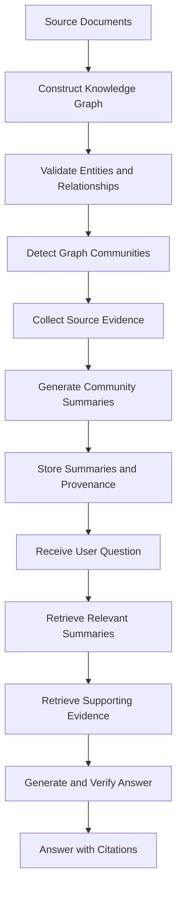

# Lesson 18: Community Detection and Summaries

File: `notes/18-graphrag-communities.md`

## 18.1 Definition

A graph community is a group of nodes that are more strongly connected to one another than to nodes outside the group.

In a knowledge graph:

- **Nodes** represent entities such as people, projects, technologies, and concepts.
- **Edges** represent relationships between entities.
- **Communities** group related entities based on the graph's connection structure.
- **Community summaries** describe the important information associated with each group.

Community detection helps organize a large knowledge graph into smaller, more understandable groups.

For example, a graph containing information about RAG might contain these topic groups:

1. **Retrieval:** vector search, embeddings, similarity search.
2. **Graph relationships:** entities, relationships, graph traversal.
3. **Evaluation:** answer correctness, retrieval relevance, citation accuracy.

A community summary describes the main entities, relationships, and supporting evidence in a particular group.

### Simple example

Suppose a knowledge graph contains:

- RAG uses document retrieval.
- Document retrieval uses vector search.
- Vector search compares embeddings.
- GraphRAG uses entity relationships.
- Graph traversal follows graph relationships.

Community detection may group the first three concepts into a retrieval-related community and the last two into a graph-related community.

The application can then summarize each group instead of repeatedly processing every individual relationship.

Important: Community detection does not simply group nodes that have similar names. It analyzes the structure of connections in the graph.

---

## 18.2 Why It Matters

A large knowledge graph may contain thousands or millions of entities and relationships.

Retrieving every node and edge for every question would be inefficient and could overwhelm the language model's context window.

Community detection and summaries help organize this information.

### Main benefits

**1. Organizes large graphs**

Related entities are grouped into communities, making the graph easier to analyze.

**2. Supports broad questions**

Questions about common themes across many documents may require evidence from multiple parts of a graph.

**3. Reduces the amount of information processed at query time**

A relevant summary can provide a compact overview of a group before the application retrieves more detailed evidence.

**4. Helps identify major themes**

Summaries can describe recurring concepts, relationships, and findings within a community.

**5. Supports hierarchical retrieval**

Some systems organize communities at multiple levels, from smaller groups to larger groups containing related communities.

**6. Preserves traceability**

When summaries retain links to their source documents and graph relationships, the application can inspect the underlying evidence before answering.

### Example

Consider 100 research reports discussing:

- Retrieval quality
- Embedding models
- Graph-based retrieval
- Evaluation methods
- Citation accuracy

A question such as:

"What are the most common challenges in these research reports?"

may require information from several related groups.

Community summaries can help the application identify important themes before selecting detailed evidence.

However, summaries can omit details or introduce errors. The application should verify important claims against the original evidence.

---

## 18.3 Key Concepts

### 1. Graph Community

A community is a group of nodes identified by their connection patterns.

For example:

- Embeddings
- Vector search
- Cosine similarity
- Semantic retrieval

These entities may belong to a retrieval-related community because they are connected through relevant relationships.

A community is not necessarily a perfect topic category. Real graphs can contain overlapping themes and connections between communities.

### 2. Community Detection

Community detection is the process of identifying groups of closely connected nodes.

Common algorithms include:

- **Louvain:** Uses modularity optimization to identify graph communities.
- **Leiden:** Detects communities through an iterative refinement process and supports hierarchical community structures.
- **Girvan–Newman:** Identifies communities by repeatedly removing selected edges that connect groups.

The algorithms have different characteristics and computational costs. The best choice depends on graph size, graph structure, and application requirements.

For this lesson, the Python exercise uses Louvain community detection when supported by the installed NetworkX version, with a greedy modularity fallback.

### 3. Modularity

Modularity is a measure used to evaluate how well a graph partition separates communities.

It compares the observed connections within groups against what would be expected under a specified random-graph baseline.

A higher modularity score can indicate a stronger community structure under that model.

However, modularity is not a complete measure of semantic quality. A graph can have a mathematically reasonable partition that does not correspond to meaningful topics.

### 4. Community Hierarchy

A large community may contain smaller communities.

For example:

- Level 1: Artificial intelligence
- Level 2: Retrieval-augmented generation
- Level 3: Vector retrieval and graph retrieval

A hierarchical structure lets the application retrieve information at different levels of detail.

A broad question may benefit from a high-level summary, while a detailed question may require a lower-level community or the original source passages.

Not every community detection algorithm produces a hierarchy in the same way.

### 5. Source Evidence

Source evidence is the original information supporting an entity or relationship.

It may include:

- Document text
- Document identifiers
- Source URLs
- Passage identifiers
- Extracted relationships
- Page numbers or other location metadata

For example:

Source ID: `doc1`

Passage: "Project Alpha uses FastAPI for its backend API."

Relationship:

`Project Alpha --uses--> FastAPI`

The source identifier allows the application to trace a claim back to its supporting evidence.

### 6. Community Summary

A community summary is a compact description of the important information associated with a community.

A useful summary may contain:

- Main topic
- Important entities
- Important relationships
- Key findings
- Supporting source identifiers
- Uncertainties or missing evidence

For example:

"**Retrieval community:** This group contains concepts related to document retrieval, vector search, embeddings, and similarity measurement. The source passages explain how vectors represent text and how similarity search identifies potentially relevant documents."

This example is an illustrative summary, not a result from a real dataset.

### 7. Summary Provenance

Provenance records where information came from and how it was produced.

For community summaries, provenance may include:

- Community ID
- Entity IDs
- Relationship IDs
- Source document IDs
- Source passage IDs
- Summary generation method
- Model name and version, when an LLM is used
- Index or data version
- Summary creation time

Provenance helps investigate incorrect summaries and verify generated answers.

### 8. Extractive and Abstractive Summaries

**Extractive summary**

Selects important sentences or passages from the original source.

Advantages:
- Preserves original wording.
- Easier to trace to source evidence.
- Can reduce unsupported paraphrasing.

Limitations:
- May be repetitive.
- May not read as naturally as a synthesized summary.

**Abstractive summary**

Generates new wording that combines information from the source evidence.

Advantages:
- Can be concise and readable.
- Can combine related facts into a coherent explanation.

Limitations:
- May omit important details.
- May introduce unsupported claims.
- Requires evidence checking and provenance.

The Python exercise below creates simple, template-based summaries from source descriptions and relationships. It does not call an LLM. A later exercise can replace this step with an LLM-based summarizer.

### 9. Community Summaries in GraphRAG

In Microsoft's GraphRAG implementation, the indexing pipeline detects communities and generates community reports. These reports can be used to help answer broad questions about a document collection.

The project also supports different query approaches, including global search over community summaries and local search focused on entities and connected information.

Community detection and summaries are general concepts; Microsoft's implementation is one specific way to use them.

Official overview: https://microsoft.github.io/graphrag/index/overview/

### 10. Summary Retrieval

At query time, the application can:

1. Analyze the user's question.
2. Identify relevant community summaries.
3. Select supporting summaries.
4. Retrieve original passages or relationships when needed.
5. Generate an answer from the selected evidence.
6. Verify important claims and provide citations.

A summary should not automatically replace the original source. Detailed questions may require returning to the underlying passages.

---

## 18.4 Architecture

The following diagram shows the main workflow for community detection and summaries.



### Architecture explanation

**Step 1: Source documents**

The application starts with documents containing useful information.

**Step 2: Construct the knowledge graph**

Entities and their relationships form the graph.

**Step 3: Validate the graph**

Check for duplicate entities, incorrect relationships, missing source references, and disconnected or unexpected nodes.

**Step 4: Detect communities**

A community detection algorithm groups nodes according to the graph structure.

**Step 5: Collect source evidence**

Collect the original passages and relationships associated with each community.

**Step 6: Generate summaries**

Create a concise description of the community's main information.

**Step 7: Store summaries and provenance**

Store each summary with its community ID and references to its supporting evidence.

**Step 8: Receive a question**

The user asks a question about the document collection.

**Step 9: Retrieve summaries**

Identify summaries relevant to the question.

**Step 10: Retrieve supporting evidence**

Retrieve source passages or relationships to check the relevant claims.

**Step 11: Generate and verify the answer**

Use the selected evidence to formulate an answer and verify important claims.

**Step 12: Answer with citations**

Return the answer with citations to the original supporting sources when available.

---

## 18.5 Python Implementation

### Goal

Build a small graph containing several related topic clusters.

Then:

1. Detect graph communities.
2. Print the entities in each community.
3. Generate one simple summary per community.
4. Store the supporting source identifiers.
5. Compare each summary with its original source passages.
6. Evaluate whether the summaries preserve the main information.

This example uses NetworkX and standard Python libraries.

The summaries are template-based, so the program can run without an API key or external LLM. This makes it easier to understand the community workflow before adding model-based summarization.

### Step 1: Install the dependency

Activate your virtual environment:

```bash
source .venv/bin/activate
```

Install NetworkX:

```bash
pip install networkx
```

### Step 2: Create the Python file

Create:

`Practical_exercise/community_detection_18.py`

Copy the complete program below.

```python
"""
Lesson 18: Community Detection and Summaries
=============================================

GOAL
----
Build a small graph containing related topic clusters.
Detect communities, generate a summary for each community,
and compare each summary with its original source passages.

WHAT THIS PROGRAM DOES
----------------------
1. Creates sample source passages.
2. Creates a graph of entities and relationships.
3. Detects graph communities using NetworkX.
4. Collects source evidence for each community.
5. Creates a simple summary for each community.
6. Stores source IDs alongside each summary.
7. Prints the summary and its original evidence.
8. Calculates a simple evidence-coverage score.

IMPORTANT LIMITATIONS
--------------------
- The sample graph is small and educational.
- Community detection is based on graph structure.
- Summaries use templates, not an LLM.
- The coverage score is a simple word-overlap heuristic.
- This is not the full Microsoft GraphRAG pipeline.
"""

import json
from pathlib import Path

import networkx as nx


# ============================================================
# 1. CONFIGURATION
# ============================================================

# Output directory for generated community reports.
# Path(__file__).resolve() makes the path independent of
# the terminal's current working directory.

OUTPUT_DIR = (
    Path(__file__).resolve().parent
    / "output"
    / "community_detection_18"
)

OUTPUT_DIR.mkdir(parents=True, exist_ok=True)


# ============================================================
# 2. SOURCE DOCUMENTS
# ============================================================

# Each source passage has:
# - id: unique source identifier.
# - text: original source passage.
#
# These passages represent our small sample dataset.
# In a real RAG system, the passages would come from
# approved documents, websites, PDFs, or other sources.

source_documents = {
    "doc1": {
        "text": (
            "Embeddings convert text into numerical vectors "
            "that represent useful features of the text."
        )
    },
    "doc2": {
        "text": (
            "Vector search compares numerical vectors to find "
            "documents relevant to a user's question."
        )
    },
    "doc3": {
        "text": (
            "Cosine similarity measures the angle-based "
            "similarity between two non-zero vectors."
        )
    },
    "doc4": {
        "text": (
            "Knowledge graphs represent entities as nodes "
            "and relationships as edges."
        )
    },
    "doc5": {
        "text": (
            "Graph traversal follows relationships between "
            "connected entities to discover related information."
        )
    },
    "doc6": {
        "text": (
            "Entity resolution identifies when different "
            "mentions refer to the same real-world entity."
        )
    },
    "doc7": {
        "text": (
            "Retrieval evaluation measures whether a system "
            "retrieves relevant evidence for a question."
        )
    },
    "doc8": {
        "text": (
            "Answer evaluation checks whether the generated "
            "answer is correct and supported by evidence."
        )
    },
    "doc9": {
        "text": (
            "Citation evaluation checks whether cited sources "
            "actually support the claims in an answer."
        )
    },
}


# ============================================================
# 3. ENTITY DEFINITIONS
# ============================================================

# Each entity has:
# - name: its name in the graph.
# - description: a description supported by source text.
# - source_ids: passages that support this description.
#
# Keeping source IDs helps us trace generated summaries
# back to the original evidence.

entities = {
    "Embeddings": {
        "description": (
            "Embeddings convert text into numerical vectors."
        ),
        "source_ids": ["doc1"],
    },
    "Vector Search": {
        "description": (
            "Vector search compares vectors to find relevant "
            "documents."
        ),
        "source_ids": ["doc2"],
    },
    "Cosine Similarity": {
        "description": (
            "Cosine similarity compares the directions of "
            "non-zero vectors."
        ),
        "source_ids": ["doc3"],
    },
    "Knowledge Graph": {
        "description": (
            "A knowledge graph represents entities as nodes "
            "and relationships as edges."
        ),
        "source_ids": ["doc4"],
    },
    "Graph Traversal": {
        "description": (
            "Graph traversal follows relationships between "
            "connected entities."
        ),
        "source_ids": ["doc5"],
    },
    "Entity Resolution": {
        "description": (
            "Entity resolution identifies mentions that refer "
            "to the same real-world entity."
        ),
        "source_ids": ["doc6"],
    },
    "Retrieval Evaluation": {
        "description": (
            "Retrieval evaluation checks whether relevant "
            "evidence is retrieved."
        ),
        "source_ids": ["doc7"],
    },
    "Answer Evaluation": {
        "description": (
            "Answer evaluation checks answer correctness "
            "and evidence support."
        ),
        "source_ids": ["doc8"],
    },
    "Citation Evaluation": {
        "description": (
            "Citation evaluation checks whether sources "
            "support answer claims."
        ),
        "source_ids": ["doc9"],
    },
}


# ============================================================
# 4. RELATIONSHIPS
# ============================================================

# Each relationship contains:
# - source entity.
# - relationship type.
# - target entity.
# - source IDs that support the relationship.
#
# For this educational graph, we connect entities that
# belong to related topic areas.
#
# In a production graph, relationships should be extracted
# or validated against actual source evidence.

relationships = [
    {
        "source": "Embeddings",
        "relation": "supports",
        "target": "Vector Search",
        "source_ids": ["doc1", "doc2"],
    },
    {
        "source": "Vector Search",
        "relation": "uses_measure",
        "target": "Cosine Similarity",
        "source_ids": ["doc2", "doc3"],
    },
    {
        "source": "Knowledge Graph",
        "relation": "supports",
        "target": "Graph Traversal",
        "source_ids": ["doc4", "doc5"],
    },
    {
        "source": "Knowledge Graph",
        "relation": "uses_concept",
        "target": "Entity Resolution",
        "source_ids": ["doc4", "doc6"],
    },
    {
        "source": "Retrieval Evaluation",
        "relation": "complements",
        "target": "Answer Evaluation",
        "source_ids": ["doc7", "doc8"],
    },
    {
        "source": "Answer Evaluation",
        "relation": "includes_check",
        "target": "Citation Evaluation",
        "source_ids": ["doc8", "doc9"],
    },
]


# ============================================================
# 5. BUILD THE GRAPH
# ============================================================

def build_graph() -> nx.Graph:
    """
    Create an undirected graph using NetworkX.

    Simple explanation:
    - Add each entity as a node.
    - Store its description and source IDs as attributes.
    - Add an edge for each relationship.
    - Store the relationship type and source IDs on the edge.

    We use an undirected graph for this community detection
    exercise because the goal is to group related entities.

    A real knowledge graph may use directed relationships
    for semantic retrieval and reasoning.
    """

    graph = nx.Graph()

    # Add all entities.
    for entity_name, data in entities.items():
        graph.add_node(
            entity_name,
            description=data["description"],
            source_ids=data["source_ids"],
        )

    # Add all relationships.
    for relationship in relationships:
        graph.add_edge(
            relationship["source"],
            relationship["target"],
            relation=relationship["relation"],
            source_ids=relationship["source_ids"],
            weight=1.0,
        )

    return graph


# ============================================================
# 6. DETECT COMMUNITIES
# ============================================================

def detect_communities(
    graph: nx.Graph,
) -> list[set[str]]:
    """
    Detect communities in the graph.

    First, use the Louvain algorithm if it is available in the
    installed NetworkX version.

    If Louvain is unavailable, use greedy modularity
    community detection.

    A community is returned as a set of entity names.
    """

    if graph.number_of_nodes() == 0:
        return []

    # Louvain is available in recent NetworkX versions.
    if hasattr(nx.community, "louvain_communities"):
        communities = nx.community.louvain_communities(
            graph,
            weight="weight",
            seed=42,
        )
    else:
        # Fallback for NetworkX versions without Louvain.
        communities = (
            nx.community.greedy_modularity_communities(
                graph,
                weight="weight",
            )
        )

    # Sorting makes the displayed results easier to read.
    return [
        set(community)
        for community in sorted(
            communities,
            key=lambda group: sorted(group)[0],
        )
    ]


# ============================================================
# 7. COLLECT COMMUNITY EVIDENCE
# ============================================================

def collect_community_evidence(
    graph: nx.Graph,
    community: set[str],
) -> dict:
    """
    Collect entity descriptions, relationships, and source IDs
    belonging to one community.

    Simple explanation:
    - Read the descriptions of the community's nodes.
    - Collect the edges whose endpoints are both in the group.
    - Collect source IDs from nodes and relationships.
    - Return everything needed to create a summary.

    This keeps the summary connected to the original evidence.
    """

    node_descriptions = []
    source_ids = set()
    community_relationships = []

    # Collect node descriptions and their source references.
    for node in sorted(community):
        node_data = graph.nodes[node]

        node_descriptions.append(
            f"{node}: {node_data['description']}"
        )

        source_ids.update(node_data.get("source_ids", []))

    # Collect relationships that are inside the community.
    for source, target, data in graph.edges(data=True):

        if source in community and target in community:
            relation = data.get("relation", "related_to")

            community_relationships.append(
                f"{source} --{relation}--> {target}"
            )

            source_ids.update(data.get("source_ids", []))

    return {
        "entities": sorted(community),
        "node_descriptions": node_descriptions,
        "relationships": sorted(community_relationships),
        "source_ids": sorted(source_ids),
    }


# ============================================================
# 8. GENERATE A SIMPLE COMMUNITY SUMMARY
# ============================================================

def generate_community_summary(
    community_id: int,
    evidence: dict,
) -> dict:
    """
    Create a simple template-based community summary.

    This function does not call an LLM.

    It combines:
    - Entity descriptions.
    - Relationships.
    - Source references.

    A production implementation could send this evidence to
    an LLM with instructions to summarize only supported facts.
    """

    entities_text = ", ".join(evidence["entities"])

    if evidence["node_descriptions"]:
        descriptions_text = " ".join(
            evidence["node_descriptions"]
        )
    else:
        descriptions_text = (
            "No entity descriptions are available."
        )

    if evidence["relationships"]:
        relationships_text = "; ".join(
            evidence["relationships"]
        )
    else:
        relationships_text = (
            "No internal relationships were recorded."
        )

    summary_text = (
        f"Community {community_id} contains the entities "
        f"{entities_text}. "
        f"Supporting descriptions: {descriptions_text} "
        f"Relationships: {relationships_text}"
    )

    return {
        "community_id": community_id,
        "title": f"Community {community_id}",
        "summary": summary_text,
        "entity_names": evidence["entities"],
        "relationships": evidence["relationships"],
        "source_ids": evidence["source_ids"],
    }


# ============================================================
# 9. COMPARE SUMMARY WITH ORIGINAL SOURCE PASSAGES
# ============================================================

def compare_summary_with_sources(
    summary: dict,
    documents: dict,
) -> dict:
    """
    Print the source passages referenced by a community summary.

    Also calculate a simple source coverage statistic.

    The coverage statistic checks how many distinct source IDs
    referenced by the summary can be found in the source dataset.

    It does NOT measure semantic correctness or answer quality.
    """

    source_ids = summary["source_ids"]

    available_sources = [
        source_id
        for source_id in source_ids
        if source_id in documents
    ]

    missing_sources = [
        source_id
        for source_id in source_ids
        if source_id not in documents
    ]

    if source_ids:
        source_coverage = (
            len(available_sources) / len(source_ids)
        )
    else:
        source_coverage = 0.0

    print("\nOriginal source passages:")

    for source_id in available_sources:
        print(f"\n[{source_id}]")
        print(documents[source_id]["text"])

    if missing_sources:
        print("\nWARNING: Missing source IDs:")
        print(missing_sources)

    print(
        "\nSource reference coverage: "
        f"{source_coverage:.0%}"
    )

    return {
        "available_source_ids": available_sources,
        "missing_source_ids": missing_sources,
        "source_reference_coverage": source_coverage,
    }


# ============================================================
# 10. SAVE COMMUNITY REPORTS
# ============================================================

def save_community_reports(
    reports: list[dict],
    output_path: Path,
) -> None:
    """
    Save all community summaries and their provenance as JSON.

    JSON makes the output easy to inspect and reuse in later
    retrieval exercises.
    """

    with output_path.open(
        "w",
        encoding="utf-8",
    ) as file:
        json.dump(
            reports,
            file,
            indent=2,
            ensure_ascii=False,
        )


# ============================================================
# 11. MAIN PROGRAM
# ============================================================

def main() -> None:
    """
    Run the complete community detection workflow.
    """

    print("=" * 70)
    print("LESSON 18: COMMUNITY DETECTION AND SUMMARIES")
    print("=" * 70)

    # Step 1: Build the graph.
    graph = build_graph()

    print("\nGRAPH STATISTICS")
    print(f"Number of entities: {graph.number_of_nodes()}")
    print(f"Number of relationships: {graph.number_of_edges()}")

    # Step 2: Detect graph communities.
    communities = detect_communities(graph)

    print(f"\nNumber of communities detected: {len(communities)}")

    # Step 3: Collect evidence and generate one summary
    # for every detected community.
    reports = []

    for community_id, community in enumerate(
        communities,
        start=1,
    ):
        print("\n" + "=" * 70)
        print(f"COMMUNITY {community_id}")
        print("=" * 70)

        # Gather entity and relationship evidence.
        evidence = collect_community_evidence(
            graph,
            community,
        )

        print("\nEntities:")
        for entity_name in evidence["entities"]:
            print(f"- {entity_name}")

        print("\nRelationships:")

        if evidence["relationships"]:
            for relationship in evidence["relationships"]:
                print(f"- {relationship}")
        else:
            print("No internal relationships.")

        # Create the community summary.
        summary = generate_community_summary(
            community_id,
            evidence,
        )

        print("\nCOMMUNITY SUMMARY")
        print(summary["summary"])

        # Compare the summary's references with the original
        # passages in the sample dataset.
        comparison = compare_summary_with_sources(
            summary,
            source_documents,
        )

        # Keep the provenance and comparison details together.
        summary["provenance"] = {
            "source_ids": summary["source_ids"],
            "method": "template_based_summary",
            "evidence_reference_coverage": (
                comparison["source_reference_coverage"]
            ),
            "missing_source_ids": (
                comparison["missing_source_ids"]
            ),
        }

        reports.append(summary)

    # Step 4: Save all reports in one JSON file.
    output_path = OUTPUT_DIR / "community_reports.json"

    save_community_reports(
        reports,
        output_path,
    )

    print("\n" + "=" * 70)
    print("SUMMARY OF RESULTS")
    print("=" * 70)

    print(f"Communities detected: {len(communities)}")
    print(f"Reports generated: {len(reports)}")
    print(f"Output file: {output_path}")

    print(
        "\nReview each summary against the original passages. "
        "Check whether the summary preserves the important facts "
        "and whether its source IDs support the claims."
    )


if __name__ == "__main__":
    main()
```

### Step 3: Run the program

From the root of your repository:

```bash
python Practical_exercise/community_detection_18.py
```

### Step 4: Check the generated output

The program creates a JSON file at:

`Practical_exercise/output/community_detection_18/community_reports.json`

Each report contains fields similar to:

```json
{
  "community_id": 1,
  "title": "Community 1",
  "summary": "Community 1 contains the entities ...",
  "entity_names": [
    "Embeddings",
    "Vector Search",
    "Cosine Similarity"
  ],
  "relationships": [
    "Embeddings --supports--> Vector Search"
  ],
  "source_ids": [
    "doc1",
    "doc2",
    "doc3"
  ],
  "provenance": {
    "source_ids": [
      "doc1",
      "doc2",
      "doc3"
    ],
    "method": "template_based_summary",
    "evidence_reference_coverage": 1.0,
    "missing_source_ids": []
  }
}
```

The exact community IDs and memberships depend on the detected partition and installed NetworkX version. The JSON example illustrates the format; it is not guaranteed to be the exact output of every run.

The source reference coverage in this program checks only whether referenced source IDs exist. It does not prove that a summary is factually correct.

---

## 18.6 Practical Exercises

### Exercise 1: Build Topic Clusters

**Goal:** Understand how relationships form graph communities.

Tasks:

1. Run `community_detection_18.py`.
2. Inspect the detected communities.
3. Identify which entities belong to each community.
4. Compare the entity groups with the intended topics: retrieval, graph relationships, and evaluation.
5. Record any unexpected grouping.

Questions:

- Why are Embeddings and Vector Search related?
- Why are Retrieval Evaluation and Citation Evaluation related?
- Can two related entities end up in different communities?
- Can an algorithm group entities that are not semantically related?

Expected learning:

Community detection uses graph structure, so the quality of the relationships affects the usefulness of the resulting groups.

### Exercise 2: Generate and Review Summaries

**Goal:** Compare each community summary with its original source passages.

Tasks:

1. Open `community_reports.json`.
2. Select one community.
3. Read its summary.
4. Find every source ID listed in the report.
5. Compare the summary with the original source passages in the program.
6. Identify any missing facts or unsupported statements.
7. Rewrite the summary manually if necessary.

Use this checklist:

| Check | Question |
|---|---|
| Accuracy | Are the statements supported by the source? |
| Coverage | Are the important facts included? |
| Clarity | Can someone understand the topic easily? |
| Redundancy | Does the summary repeat information? |
| Provenance | Can the supporting passages be found? |

Expected learning:

A summary is useful only when it preserves the important information and remains traceable to evidence.

### Exercise 3: Add a New Topic Cluster

**Goal:** Understand how new entities and relationships affect community detection.

Add three new entities to the `entities` dictionary:

- `Reranking`
- `Cross-Encoder`
- `Retrieval Ranking`

Give each entity a description and a valid source ID.

Add corresponding source passages to `source_documents`.

Then add relationships such as:

```python
{
    "source": "Reranking",
    "relation": "uses",
    "target": "Cross-Encoder",
    "source_ids": ["doc10"],
}
```

Add another relationship connecting `Reranking` to `Retrieval Ranking`, and make sure the source IDs reference actual documents.

Tasks:

1. Run the program again.
2. Compare the number of communities.
3. Inspect the new community membership.
4. Check whether the new summaries include the added evidence.

Expected learning:

Adding entities and edges can change the graph's community structure. Community membership is determined by the algorithm, not simply by the order in which entities are entered.

### Exercise 4: Test a Weak Relationship

**Goal:** Understand how graph structure influences community detection.

Tasks:

1. Add a relationship connecting two entities from different topic areas.
2. Run community detection again.
3. Observe whether the community membership changes.
4. Remove the relationship and run the program again.
5. Compare the results.

Questions:

- Did the new edge change the community partition?
- Did the change improve or reduce topic coherence?
- Why should relationships be validated before community detection?

Expected learning:

Incorrect or overly broad relationships can make communities less meaningful.

### Exercise 5: Compare Extractive and Abstractive Summaries

**Goal:** Understand different summary generation methods.

The current program uses a template-based approach.

Tasks:

1. Select one community.
2. Create an extractive summary by selecting important original sentences.
3. Create an abstractive summary by rewriting the information in your own words.
4. Compare both summaries against the original evidence.
5. Record differences in readability, coverage, and traceability.

Expected learning:

Extractive summaries preserve original wording, while abstractive summaries can be more concise but need careful evidence checking.

---

## 18.7 Common Problems

### Problem 1: Communities Do Not Match the Expected Topics

**Possible causes:**

- Missing relationships.
- Incorrect edges.
- Too few nodes.
- Weak graph structure.
- Different community detection algorithms or parameters.

**Solutions:**

- Inspect the nodes and edges.
- Validate relationship quality.
- Add missing relationships only when supported by evidence.
- Compare multiple algorithms or settings.
- Review semantic coherence rather than judging solely by the number of communities.

### Problem 2: All Entities End Up in One Community

Possible causes include strong connections across the graph or a partition that does not separate the topics at the chosen settings.

Solutions:

- Inspect cross-topic edges.
- Check whether unrelated entities are connected too strongly.
- Experiment with the algorithm's resolution setting when supported.
- Compare the result with a known partition for a small test graph.

Do not remove valid relationships simply to force a preferred result.

### Problem 3: Too Many Small Communities

Possible causes:

- The graph is sparse.
- Entities lack connecting relationships.
- The algorithm or its parameters favor smaller groups.

Solutions:

- Check for missing edges.
- Inspect isolated nodes.
- Compare alternative community detection settings.
- Verify whether the graph genuinely contains separate topics.

### Problem 4: Summaries Contain Unsupported Claims

Possible causes:

- The summarization process introduces information not present in the sources.
- Source passages are incomplete.
- Relationships were extracted incorrectly.
- Evidence from different entities was combined incorrectly.

Solutions:

- Include only supported information.
- Preserve source IDs.
- Inspect the original passages.
- Verify each important claim.
- Use an explicit insufficient-evidence response when necessary.

### Problem 5: Summaries Lose Important Details

Possible causes:

- The summary is too short.
- The summarization prompt prioritizes brevity over coverage.
- The evidence collection misses some relationships.
- Important sources are not associated with the community.

Solutions:

- Collect all relevant source passages.
- Check the community's entity and relationship coverage.
- Use a structured summary containing main findings and evidence.
- Evaluate summaries against known facts.

### Problem 6: Source IDs Are Missing or Incorrect

Possible causes:

- An entity has no source reference.
- A relationship points to a nonexistent document.
- Source identifiers changed during ingestion.
- Summary provenance was not updated.

Solutions:

- Validate source IDs before generating summaries.
- Check that every referenced ID exists.
- Preserve stable document and passage identifiers.
- Rebuild affected summaries when the underlying evidence changes.

### Problem 7: GraphRAG Processing Is Expensive

Community detection and summary generation can require substantial computation on large graphs.

Solutions:

- Measure graph size and processing time.
- Avoid unnecessary LLM calls.
- Summarize only when the application benefits from the summaries.
- Cache summaries while their evidence remains unchanged.
- Regenerate affected summaries when relevant data changes.

---

## 18.8 Evaluation

Community detection and summary generation should be evaluated separately.

A graph can have good community structure but poor summaries. Similarly, a readable summary may describe a community that was formed from incorrect relationships.

### 1. Community Coherence

Check whether the entities grouped together share meaningful topics or relationships.

Questions:

- Do the entities belong together?
- Are the relationships relevant?
- Are unrelated concepts mixed together?

### 2. Community Separation

Check whether clearly different topic areas are kept sufficiently separate.

A community algorithm may group some related topics together. Whether that is a problem depends on the application.

### 3. Summary Accuracy

Check whether the summary's claims are supported by the source evidence.

### 4. Summary Coverage

Check whether the summary contains the important facts and relationships from the community.

A summary can be accurate but incomplete.

### 5. Provenance Completeness

Check whether each summary retains usable references to its supporting entities, relationships, and source passages.

### 6. Retrieval Usefulness

Check whether retrieving community summaries improves answers to broad questions compared with using ordinary document retrieval alone.

### 7. Latency and Cost

Measure the time and resources needed to:

- Detect communities.
- Collect supporting evidence.
- Generate summaries.
- Retrieve summaries for questions.

### Evaluation checklist

| Metric | What to check |
|---|---|
| Community coherence | Do grouped entities make sense together? |
| Community separation | Are different topics distinguishable? |
| Summary accuracy | Are claims supported by sources? |
| Summary coverage | Are important facts included? |
| Provenance | Can the original evidence be traced? |
| Answer quality | Do summaries improve answers to broad questions? |
| Latency | How long does processing take? |
| Cost | What computation or model usage is required? |

### Important note about the example program

The sample code prints a source reference coverage value. This checks whether referenced source IDs exist; it is not a complete summary-quality metric.

For a stronger evaluation, create a small test dataset with expected entities, relationships, and key facts. Compare each generated summary against that expected information and manually review unsupported claims.

---

## 18.9 Key Learnings

After completing this lesson, you should understand:

1. A graph community is a group of connected nodes.
2. Community detection identifies groups based on graph structure.
3. Algorithms such as Louvain and Leiden can discover graph communities.
4. Modularity is one way to evaluate a graph partition, but it does not prove semantic quality.
5. Community summaries describe the main information associated with a group.
6. Source evidence and provenance help verify summary claims.
7. Template-based, extractive, and abstractive summaries have different strengths.
8. Community summaries can help answer broad questions over large document collections.
9. Summaries may omit facts or introduce errors, so important claims should be checked against source evidence.
10. Community detection and summary generation are related but separate stages.
11. Graph structure, source quality, and summarization quality all affect the final result.
12. Microsoft's GraphRAG is one implementation of these concepts, not the only possible approach.

**Main takeaway:**

Community detection organizes a knowledge graph into related groups, and community summaries make those groups easier to use for retrieval and broad question answering. Reliable summaries must remain grounded in their original evidence.

---

## 18.10 References

### Official documentation

1. **Microsoft GraphRAG — Overview**

   Explains the indexing pipeline, community detection, community summaries, and query methods.

   https://microsoft.github.io/graphrag/index/overview/

2. **Microsoft GraphRAG — Outputs**

   Describes the generated community and community-report data, including fields for community membership and summaries.

   https://microsoft.github.io/graphrag/index/outputs/

3. **NetworkX — Community detection algorithms**

   Documents available community detection and partition evaluation algorithms.

   https://networkx.org/documentation/stable/reference/algorithms/community.html

4. **NetworkX — Louvain community detection**

   Explains the Louvain algorithm and its parameters.

   https://networkx.org/documentation/stable/reference/algorithms/generated/networkx.algorithms.community.louvain.louvain_communities.html

### Relevant research

5. Blondel et al. (2008), *Fast unfolding of communities in large networks.*

   Introduces the Louvain method for community detection.

   https://doi.org/10.1088/1742-5468/2008/10/P10008

6. Edge et al. (2024), *From Local to Global: A Graph RAG Approach to Query-Focused Summarization.*

   Explores the GraphRAG approach to answering questions about information across a collection.

   https://arxiv.org/abs/2404.16130

---

## Final practical task

Before moving to the next lesson:

- [ ] Run `community_detection_18.py`.
- [ ] Inspect every detected community.
- [ ] Compare each summary with its original source passages.
- [ ] Verify that source IDs exist and support the summary.
- [ ] Add a new topic cluster and run the program again.
- [ ] Record what changed in the community structure.
- [ ] Explain why community summaries can help with broad questions.